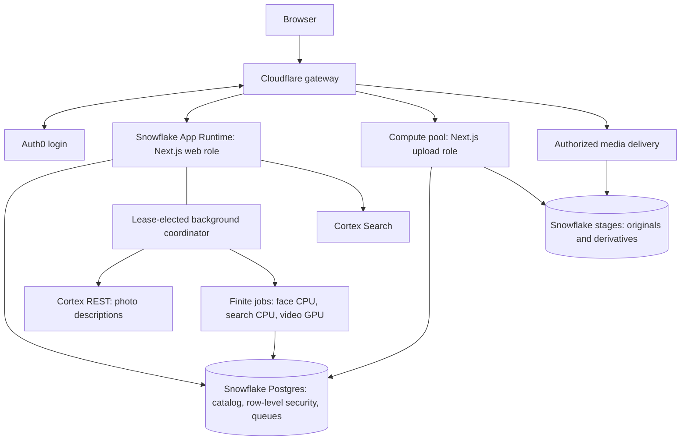

# Stillmark

> **What this repository is.** A complete photo and video platform built on Snowflake,
> written entirely by directing AI coding agents. Its owner has no programming
> background and wrote none of the code by hand. It is published as an example of what
> that way of working can produce, and so that engineers can judge the result: the
> architecture, the tests, the security model and the release process.
>
> **What it is not.** It is not a one-click install. The application runs in
> production from a private repository; this is a snapshot of that code with no
> history. Real account identifiers and personal names are replaced with placeholders
> (`exampleorg-exampleacct`, `photos.stillmark.example` and similar), records listing known
> unpatched packages in the running system are left out, and the automation under
> `docs/reference/` is an inactive copy, so nothing runs here. Standing up your own
> copy needs a Snowflake account, an Auth0 tenant, a Cloudflare account and a domain,
> and the `setup/` folder is a history of how this system grew, not an installer.
>
> The unit tests run anywhere: `npm ci && npm test`.

Stillmark is a private photo and video library that runs almost entirely on
Snowflake. It is a working production application and a deliberate showcase: the web
app, the database, media storage, background workers, AI descriptions and semantic
search all use Snowflake services, with Cloudflare and Auth0 at the public edge.

[Architecture](docs/ARCHITECTURE.md) · [Repository map](docs/REPOSITORY-MAP.md) ·
[Threat model](docs/THREAT-MODEL.md) · [Releases](docs/SAFE-RELEASES.md) ·
[All documentation](docs/README.md)

## Architecture at a glance



The [architecture guide](docs/ARCHITECTURE.md) has the full diagram, the critical
flows and a glossary.

## Snowflake services used

| Service                         | Used for                                                  | Where to look                                                                 |
| ------------------------------- | --------------------------------------------------------- | ----------------------------------------------------------------------------- |
| App Runtime                     | The Next.js web application                               | `app.yml`, `app/`, `instrumentation.ts`                                       |
| Snowflake Postgres              | Catalog, permissions, row-level security, durable queues  | `migrations/postgres/`, `lib/database/database-context.ts`, `lib/postgres.ts` |
| Snowpark Container Services     | Upload service and finite face, search and GPU video jobs | `workers/`                                                                    |
| Internal stages                 | Original media, thumbnails, display copies, renditions    | `lib/snowflake/stage-upload.ts`, [stage uploads](docs/STAGE-UPLOADS.md)       |
| Cortex REST                     | Photo descriptions                                        | `lib/ai-categorize.ts`, [AI descriptions](docs/AI-DESCRIPTIONS.md)            |
| Cortex Search                   | Semantic photo and album search                           | `lib/search/search-semantic.ts`, [search](docs/SEARCH-INTERPRETATION.md)      |
| Secrets and network rules       | Credentials and outbound access, never committed          | [runtime identities](docs/RUNTIME-IDENTITIES.md)                              |
| Account usage and billing views | Per-user and per-feature cost reports                     | `lib/costs/cost-report.ts`, [cost attribution](docs/COST-ATTRIBUTION.md)      |

## Design decisions worth reviewing

- **The database enforces tenancy.** Every catalog query runs in a transaction that
  carries the verified user identity and a read-only or writer role; row-level
  security decides what is visible. Application roles cannot bypass it, and
  maintenance work uses a separate credential.
  See [catalog row-level security](docs/CATALOG-RLS.md).
- **One codebase, two deployment roles.** The upload service is the same Next.js
  application built into a container and started with `UPLOAD_SERVICE_ONLY=true`, so
  authorization, validation and publication are a single tested code path. The web
  role never relays upload bytes. See the [upload worker](workers/upload-cpu/README.md).
- **Background work survives restarts.** One web instance holds a lease and
  coordinates background work. PostgreSQL `LISTEN/NOTIFY` wakes it; a periodic recovery
  pass covers lost notifications; leases and fencing tokens stop a stale worker from
  publishing. See [the architecture guide](docs/ARCHITECTURE.md#background-work).
- **Compute that scales to zero.** Uploads, face recognition, search enrichment and
  GPU video preparation each run on their own pool or as finite jobs that stop when
  idle. Browsing does not resume a SQL warehouse.
- **Releases are gated, not trusted.** A release runs type checks, about 2,300 tests,
  native PostgreSQL permission and concurrency checks, a production build, a backup
  restore drill, worker image builds with vulnerability scans, and a secret scan
  before it deploys. Migrations are forward-only with a checksum ledger.
  See [safe releases](docs/SAFE-RELEASES.md).
- **Supply chain is pinned.** CI actions are pinned to commit hashes, base images to
  digests, and Python dependencies to hash-locked files. Every accepted unfixed
  advisory has a written, expiring review bound to the source files it depends on.

## How this is built and verified

The code is written with AI coding agents under the owner's direction. Nothing is
trusted because an agent wrote it: every change must pass the release gates above,
security-relevant changes get an independent review, and advisory reviews cannot be
re-confirmed without the owner's sign-off. [AGENTS.md](AGENTS.md) holds the standing
instructions agents work under.

## Known limitations

- **Single deployment.** The repository carries one deployment profile
  ([config/deployment.json](config/deployment.json)). Account names, hosts and client
  identifiers in it are not credentials; secrets live in Snowflake secrets and
  Cloudflare Worker secrets.
- **No verified fresh-install path.** `setup/` is an immutable record of how the
  first environment was built, not a bootstrap sequence. The current schema baseline
  used by tests is `tests/fixtures/rls-schema.sql`. [Rebuilding the system](docs/REBUILD.md)
  lists what can be rebuilt today and how well each path is proven.
- **Scale is designed, not demonstrated.** The
  [target-state design](docs/architecture/stillmark-target-state.md) describes read
  replicas, sharding and multiple cells that are not built. Production runs one small
  deployment, and the one-million-user objective has not been measured.
- **Background coordination runs inside the web process.** This keeps the deployment
  to one service at the cost of coupling scheduling to web availability.
- **Accepted advisories.** The upload and face images contain unfixed operating-system
  advisories that were reviewed as unreachable, not patched. The reviews expire and
  must be redone. See [safe releases](docs/SAFE-RELEASES.md#actual-worker-images-and-dependency-security).

## Naming

Stillmark is the product name. `personal-photos`, `PERSONAL_PHOTOS_*` and
`PERSONAL_MEDIA` are the original repository and Snowflake object names, kept because
renaming deployed objects would add risk for no functional gain.

## Features

- Albums and user-owned folders, favorites, bulk moves, editable metadata, location
  mapping, and expiring album share links.
- Chunked, resumable uploads with metadata extraction.
- Photo descriptions and natural-language search; administrator-triggered video analysis.
- GPU video playback preparation with durable progress and bounded retries; original
  files are always preserved.
- People review, face recognition and location-based browsing.
- Self-service signup with per-member allowances, access management, activity and
  cost reports.

Upload limits are 64 MiB per image and 4 GiB per video, sent in 8 MiB chunks;
[lib/upload/upload-limits.ts](lib/upload/upload-limits.ts) is authoritative.

## Runtime components

| Component           | Source                                                           | Responsibility                                                |
| ------------------- | ---------------------------------------------------------------- | ------------------------------------------------------------- |
| Web app             | `app/`, `lib/`, `components/`                                    | Gallery, permissions, catalog, background coordination        |
| Database            | `migrations/postgres/`, `lib/database/database-context.ts`       | Transaction-scoped identity, row-level security, durable jobs |
| Gateway             | `cloudflare-gateway/`                                            | Login, sessions, authorized media delivery, alerts            |
| Upload service      | Same application code; image and limits in `workers/upload-cpu/` | Chunk intake and durable processing on its own pool           |
| Face/search workers | `workers/face-cpu/`, `workers/search-cpu/`                       | Finite CPU recognition and enrichment jobs                    |
| GPU worker          | `workers/video-gpu/`                                             | Video playback renditions on a separate pool                  |
| Setup history       | `setup/`                                                         | Immutable record of earlier changes; not a bootstrap          |

`app.yml` and the worker production specifications are rendered from
[config/deployment.json](config/deployment.json) and `config/templates/`; change the
profile or a template, never the rendered file alone. See
[deployment configuration](docs/DEPLOYMENT-CONFIGURATION.md).

## Local development

Use Node.js 22 and an isolated development environment; follow the
[development guide](docs/DEVELOPMENT.md) before starting the server. Credentials
belong in local secret configuration, never in Git.

```sh
npm ci
npm run dev
npm run check
npm run format:check
```

## Releases

`python3 scripts/release/deploy.py --connection stillmark-deploy --deploy` runs the
release gates from a clean, committed checkout, deploys through Snowflake and records
the result. The gateway and each worker image are released separately. A Git commit
is not a deployment record: read deployed versions from live service metadata.
See [safe releases](docs/SAFE-RELEASES.md) and [production operations](docs/PRODUCTION.md).

## Licence

[MIT](LICENSE). Third-party components keep their own licences; see
[face worker licences](workers/face-cpu/LICENSES.md) and
[search worker licences](workers/search-cpu/LICENSES.md).
