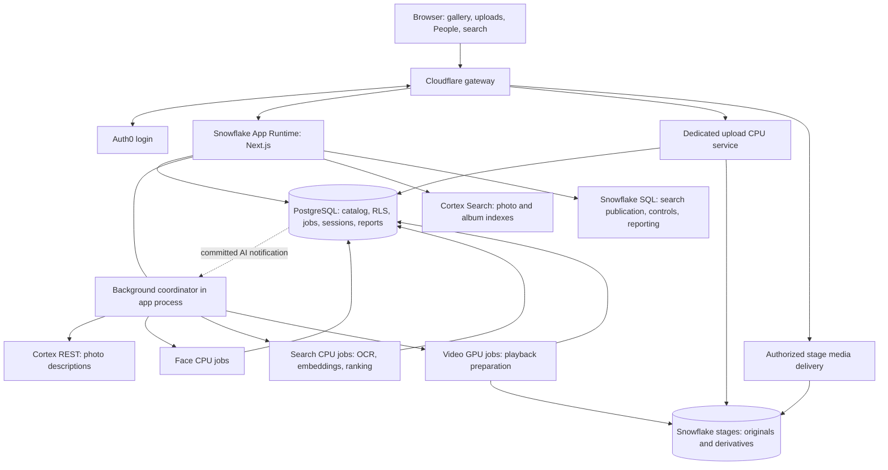

# Stillmark architecture

This guide describes what is implemented. Inspect live service metadata for current
sizes, states, versions and grants. The design documents under `architecture/` and
`security/` describe a target state that is only partly built; each carries a status
note.

## Glossary

| Term                        | Meaning here                                                                                            |
| --------------------------- | ------------------------------------------------------------------------------------------------------- |
| App Runtime                 | Snowflake's managed hosting for the web application (an "Application Service").                         |
| Compute pool                | Snowflake-managed machines that run container services and jobs.                                        |
| Finite job                  | A container that starts for a batch of work and exits; nothing runs while idle.                         |
| Stage                       | Snowflake-managed object storage; holds originals and derived media.                                    |
| Row-level security (RLS)    | PostgreSQL policies that decide, per row, what the current user may read or change.                     |
| Admission                   | Deciding whether to accept new work now (an upload, an AI call, a search) or ask the client to retry.   |
| Lease                       | A time-limited claim on a job, renewed by heartbeat; an expired lease lets another worker take over.    |
| Fencing                     | A per-claim token checked at publication, so a worker whose lease expired cannot publish stale results. |
| Coordinator                 | The one web instance that currently holds the lease to schedule background work.                        |
| GALLERY                     | Album visibility that shows an album to every signed-in user; the alternative is private.               |
| External access integration | Snowflake's allow-list for outbound network access from a service.                                      |

## Compute and storage

| Service                          | Execution                                     | Source                                                                        |
| -------------------------------- | --------------------------------------------- | ----------------------------------------------------------------------------- |
| App/API and coordinator          | App Runtime managed compute                   | [app.yml](../app.yml), [instrumentation.ts](../instrumentation.ts)            |
| Upload intake/processing         | Dedicated CPU pool, independent image/service | [upload worker](../workers/upload-cpu/README.md)                              |
| Face detection/recognition       | Finite CPU jobs                               | [face worker](../workers/face-cpu/README.md)                                  |
| Search enrichment/replay         | Finite CPU jobs                               | [search worker](../workers/search-cpu/README.md)                              |
| Playback preparation             | Finite GPU jobs                               | [video worker](../workers/video-gpu/README.md)                                |
| Catalog and queues               | Snowflake-managed PostgreSQL                  | [RLS](CATALOG-RLS.md), [migrations](../migrations/postgres)                   |
| Original/derived bytes           | Snowflake internal stages                     | [stage upload](STAGE-UPLOADS.md)                                              |
| AI and semantic retrieval        | Cortex services                               | [AI](AI-DESCRIPTIONS.md), [search interpretation](SEARCH-INTERPRETATION.md)   |
| SQL control/reporting            | Configured query warehouse where required     | [profile](../config/deployment.json), [cost attribution](COST-ATTRIBUTION.md) |
| Public authentication/media edge | Cloudflare Worker and Auth0                   | [gateway](../cloudflare-gateway/README.md)                                    |

App compute, worker pools, PostgreSQL, warehouse SQL and Cortex are different
billing/scale boundaries. Browsing primarily uses PostgreSQL and stage media;
that does not imply zero Snowflake cloud-services usage.

## Critical flows

**Upload:** authenticated intent → chunk acceptance → durable queue → upload worker
lease → metadata/renditions → catalog publication. Original bytes stay in stages.
The browser can close after acceptance; unfinished transfers require local files.

**Photo AI:** committed queue notification wakes the elected coordinator; durable
claims and a periodic recovery pass survive notification loss/restarts. AI calls
are bounded separately from image preparation. Results update the catalog and
become eligible for search publication.

**Search:** structured metadata/people filters and semantic retrieval have distinct
roles. PostgreSQL remains the permission authority. Search sessions and returned
photos are checked against current access. Update Search enrichment is a bounded
job chain; Sync Search publishes revisions/removals. Neither regenerates all AI
photo descriptions automatically.

**Media:** authorization and cached bytes are separate. Thumbnail batching and
signed media grants reduce repeated work without making private storage public.
See [gateway documentation](../cloudflare-gateway/README.md) for exact expiry,
transport and cache boundaries.

## One codebase, two deployment roles

The web application and the upload service are the same Next.js code. The upload
image ([Dockerfile](../workers/upload-cpu/Dockerfile)) builds the application and
starts it with `UPLOAD_SERVICE_ONLY=true`; [instrumentation.ts](../instrumentation.ts)
and [proxy.ts](../proxy.ts) then enable only chunk intake, completion and the
processing queue, and refuse everything else. The web role never relays upload bytes.

This was chosen over a separate upload codebase so that authorization, album rules,
file validation and catalog publication exist once and are tested once. The cost is
that the upload image carries the whole application and must be rebuilt when shared
code changes.

## Background work

[instrumentation.ts](../instrumentation.ts) starts the loops below in the web
process. Only the instance holding the coordinator lease
([background-coordinator.ts](../lib/database/background-coordinator.ts)) does work; the others
skip each tick. Every loop reads durable state from PostgreSQL, so a restart or a
change of coordinator loses no work.

| Loop                               | Interval | Durable state                           |
| ---------------------------------- | -------: | --------------------------------------- |
| Upload service start/suspend       |     10 s | Upload routing and lifecycle rows       |
| Photo descriptions                 |     60 s | AI queue claims; also woken by `NOTIFY` |
| Video analysis and playback status |  10–30 s | Video job rows                          |
| Playback preparation               |     30 s | Preparation queue and job leases        |
| Face scan                          |     30 s | Face scan runs and claims               |
| Search enrichment and publication  |     60 s | Search batch and revision rows          |
| People matching                    |     10 s | Pending match rows                      |
| Cleanup and retention              |  15–60 s | Cleanup intents and expiry timestamps   |

Polling inside the web process keeps the deployment to one service and needs no
scheduler of its own. The trade-offs are that scheduling depends on a web instance
being up, and that idle traffic is low but not zero. With more web instances the
lease still elects exactly one coordinator. A dedicated scheduler service or
Snowflake tasks would be the next step if background load grew beyond one instance.

## Change boundaries

Generated configuration comes from profile/templates. PostgreSQL forward migrations
use the release ledger; historical setup scripts are frozen. Worker images and the
gateway are separate releases. See [repository map](REPOSITORY-MAP.md),
[testing](TESTING.md) and [production operations](PRODUCTION.md).
