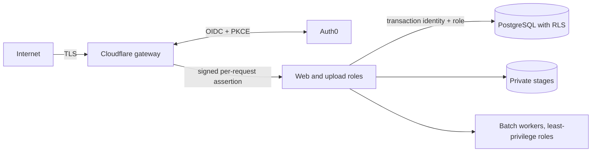

# Threat model

This describes the deployed system: what is protected, from whom, by which control,
and which risks are knowingly accepted. Each control names the code that implements
it. The [target-state security design](security/stillmark-security-design.md) covers
planned controls and is not a description of production.

## Assets

| Asset                                  | Why it matters                                                 |
| -------------------------------------- | -------------------------------------------------------------- |
| Private photos, videos and derivatives | Personal media; exposure cannot be undone.                     |
| Catalog metadata                       | Locations, dates, people and descriptions reveal private life. |
| Face data                              | Biometric embeddings and identity labels.                      |
| Accounts and sessions                  | Control access to all of the above.                            |
| Service credentials                    | Database, gateway signing and provider secrets.                |
| Spend                                  | AI inference, GPU and storage can be driven up by abuse.       |

## Trust boundaries

1. **Internet to gateway.** Nothing is trusted. The only anonymous routes are login,
   the landing page and exact share-link paths.
2. **Gateway to application.** The application trusts a request only if it carries a
   valid gateway assertion; it never trusts browser-supplied identity or roles.
3. **Application to database.** The application is trusted to state who the verified
   user is; the database decides what that user may see.
4. **Application to workers.** Workers hold narrower database roles than the
   application and publish only under a valid lease.

## Adversaries and controls

| Adversary and goal                                                         | Control                                                                                                                                                                                                                                                                                                       | Where                                                                                                                     |
| -------------------------------------------------------------------------- | ------------------------------------------------------------------------------------------------------------------------------------------------------------------------------------------------------------------------------------------------------------------------------------------------------------- | ------------------------------------------------------------------------------------------------------------------------- |
| Anonymous visitor reads private media                                      | Every non-public route requires a session; media is served only after authorization                                                                                                                                                                                                                           | `cloudflare-gateway/worker.mjs`, `cloudflare-gateway/proxy.mjs`                                                           |
| Anonymous visitor guesses a share link                                     | 256-bit random token, only its SHA-256 stored, expiry capped at 90 days, exact route allowlist, strict content security policy on the share page                                                                                                                                                              | `lib/albums/public-albums.ts`, `cloudflare-gateway/public-share-route.mjs`, `app/share/[token]/route.ts`                  |
| Signed-in member reads another member's private albums                     | Row-level security on catalog tables with a transaction-scoped identity; application roles cannot bypass it                                                                                                                                                                                                   | `lib/database/postgres-transaction-start.ts`, `migrations/postgres/`, [RLS guide](CATALOG-RLS.md)                         |
| Member escalates to administrator                                          | Roles come from the server-side identity record, never from the browser or the session cookie; administrative writes re-check the role                                                                                                                                                                        | `lib/identity/auth.ts`, `lib/identity/gateway-auth.ts`, `lib/access-management/authority.ts`                              |
| Attacker bypasses the gateway and calls the origin directly                | The origin requires a gateway-signed HMAC assertion bound to method and path, valid for 30 seconds, with a replay identifier                                                                                                                                                                                  | `cloudflare-gateway/proxy.mjs`, `lib/identity/gateway-assertion.ts`                                                       |
| Attacker forges identity headers                                           | The gateway strips inbound `authorization`, `cookie`, `sf-*` and `x-photo-*` headers before forwarding                                                                                                                                                                                                        | `cloudflare-gateway/proxy.mjs`                                                                                            |
| Stolen or copied session cookie                                            | Encrypted `__Host-` cookies; logout writes a revocation the application checks on every request, and fails closed if the write fails                                                                                                                                                                          | `cloudflare-gateway/auth.mjs`, [session revocation](SESSION-REVOCATION.md)                                                |
| An attacker with a member's session queues uploads before being locked out | Queued uploads are re-authorized from the database when access changes and again at publication; disabling the account stops them. A password reset or sign-out alone does not ([queued uploads](queued-upload-processing.md))                                                                                | `lib/identity/queued-upload-authority.ts`, `lib/upload/upload-processing-worker.ts`                                       |
| Cross-site request forgery                                                 | State-changing API routes require a same-origin request; cookies are `SameSite=Lax`                                                                                                                                                                                                                           | `lib/identity/auth.ts` (`requireSameOrigin`)                                                                              |
| Injected markup loads or sends data to an outside host                     | An enforced content security policy on every page: nonce-only scripts, and images, media, connections, styles, fonts, workers and form targets limited to the site itself plus the one map tile host                                                                                                          | `proxy.ts`, `lib/content-policy.mjs`                                                                                      |
| Cross-site link forces a sign-out                                          | Logout refuses requests the browser marks as cross-site                                                                                                                                                                                                                                                       | `cloudflare-gateway/auth.mjs`                                                                                             |
| Password guessing, signup flooding or share-link scraping                  | Per-client request ceilings at the gateway for sign-in and public share routes, in front of Auth0's own attack protection                                                                                                                                                                                     | `cloudflare-gateway/rate-limit.mjs`, `cloudflare-gateway/wrangler.jsonc`                                                  |
| Login interception or token substitution                                   | Authorization-code flow with PKCE, state and nonce; RS256 pinned; issuer, audience and authorized-party checks                                                                                                                                                                                                | `cloudflare-gateway/auth.mjs`                                                                                             |
| Malicious upload exploits a media parser                                   | Type and size limits, bounded decoders, non-root containers, fixed subprocess commands, digest-pinned images, hash-locked dependencies                                                                                                                                                                        | `lib/upload/upload-limits.ts`, `lib/upload/upload-file-kind.ts`, `workers/upload-cpu/Dockerfile`                          |
| Member drives up cost                                                      | Admin-set lifetime upload and storage allowances, daily paid-search allowance, admission limits on AI, search and upload                                                                                                                                                                                      | [customer accounts](CUSTOMER-ACCOUNTS.md), `lib/photos/photo-ai-admission.ts`, `lib/search/search-admission.ts`           |
| SQL injection                                                              | Parameterised queries throughout; identifiers that must be interpolated are validated against a strict pattern                                                                                                                                                                                                | `lib/postgres.ts`, `lib/snowflake/query-execution.ts`                                                                     |
| Compromised dependency or build step                                       | CI actions pinned to commit hashes, read-only workflow permissions, no production secrets in CI, secret scanning, image scans with an SBOM                                                                                                                                                                    | `docs/reference/github-quality-workflow.yml`, [safe releases](SAFE-RELEASES.md)                                           |
| A stale or duplicated worker overwrites newer results                      | Leases with heartbeats and a fencing token checked at publication                                                                                                                                                                                                                                             | `lib/upload/upload-processing-jobs.ts`, `workers/face-cpu/worker.py`                                                      |
| Secrets leak through the repository or logs                                | Secrets live only in Snowflake and Cloudflare secret stores; history is scanned on every release; diagnostics log categories, not values                                                                                                                                                                      | `.gitleaks.toml`, `scripts/release/check.py`, `cloudflare-gateway/diagnostics.mjs`                                        |
| Photos sent to an outside AI provider reach somewhere unintended           | Off by default: descriptions stay on Snowflake Cortex. When the owner selects OpenAI, the sender uses one fixed address, refuses redirects, sends only the resized display image and the instructions, asks for no retention, and never stores provider error text; the outbound rule allows that single host | `lib/ai/openai-photo.ts`, `tests/openai-photo.test.ts`, `migrations/snowflake/202611230900_openai_photo_descriptions.sql` |

## Accepted risks

These are known and deliberately not addressed today.

| Risk                                                                                                                                                                                           | Why it is accepted                                                                                                                                                                                                      | What would change the decision                                                        |
| ---------------------------------------------------------------------------------------------------------------------------------------------------------------------------------------------- | ----------------------------------------------------------------------------------------------------------------------------------------------------------------------------------------------------------------------- | ------------------------------------------------------------------------------------- |
| A compromised application server can assert any user identity to the database                                                                                                                  | Row-level security defends against application bugs, not against code execution in the application                                                                                                                      | Moving identity assertion to a database-verified token                                |
| Shared albums marked GALLERY are visible to every signed-in user, and signup is open                                                                                                           | Intended: the library is a showcase                                                                                                                                                                                     | Storing media that is not meant to be shown                                           |
| Uploads are validated and decoded but not scanned for malware                                                                                                                                  | Media is re-encoded for display; originals are served only to authorized users as downloads                                                                                                                             | Sharing originals with untrusted recipients                                           |
| Worker images contain unfixed operating-system advisories                                                                                                                                      | Each is reviewed as unreachable, bound to the source it depends on, and expires after at most 30 days, with a weekly automated rescan of the deployed image digests ([details](SAFE-RELEASES.md#what-each-scan-proves)) | A fix becoming available, which blocks the release gate                               |
| Media-handling code bundled inside other components (the static FFmpeg build, libvips, libheif, OpenCV, the database client's TLS library) is not covered by the operating-system package scan | The scanner reports distribution packages; bundled native code has no equivalent inventory except in the video image                                                                                                    | A bundled-component inventory and advisory feed for every image                       |
| The face worker opens any image format its imaging library supports, not only the four it is meant to receive                                                                                  | Inputs are photos the upload service already validated and decoded once; no external decoder is installed                                                                                                               | Restricting the accepted formats at the next face image rebuild                       |
| The face worker passes results between its two processes with Python's native serialization                                                                                                    | Both processes are the same code in the same container; a decoder compromise in the child would reach the parent's database credential                                                                                  | Moving to a data-only format between the processes                                    |
| Worker images still contain system tools that nothing uses (mount, nsenter, the package installer)                                                                                             | Reviews show none is invoked and the containers run as an unprivileged user; they matter only after code execution                                                                                                      | Removing them at the next image rebuild, which turns "not invoked" into "not present" |
| One administrator; changes reach `main` without a second human reviewer                                                                                                                        | Single-owner project; the automated release gates and independent reviews are the control                                                                                                                               | A second maintainer                                                                   |
| Deployment identifiers (account locator, hosts, client IDs) are committed                                                                                                                      | They are not credentials; the origin still requires the gateway assertion                                                                                                                                               | A multi-environment deployment                                                        |

## Not claimed

- Live grants, network policies and provider settings are not proven by this
  repository; verify them against the running system.
- Passing tests show that specified behaviour holds, not that no vulnerability exists.
- The scale and multi-tenant controls in the target-state design are not built.
