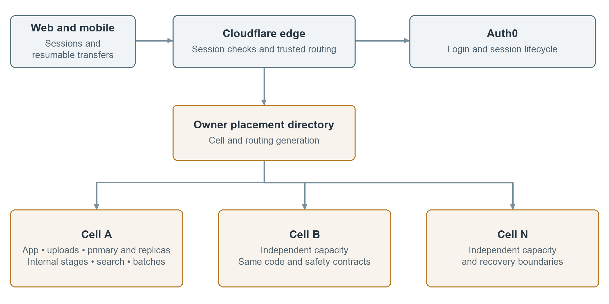
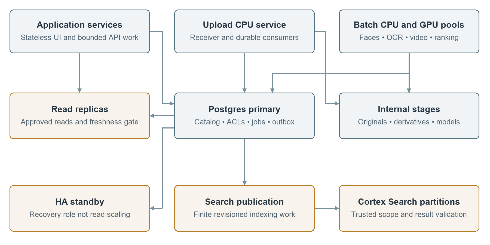
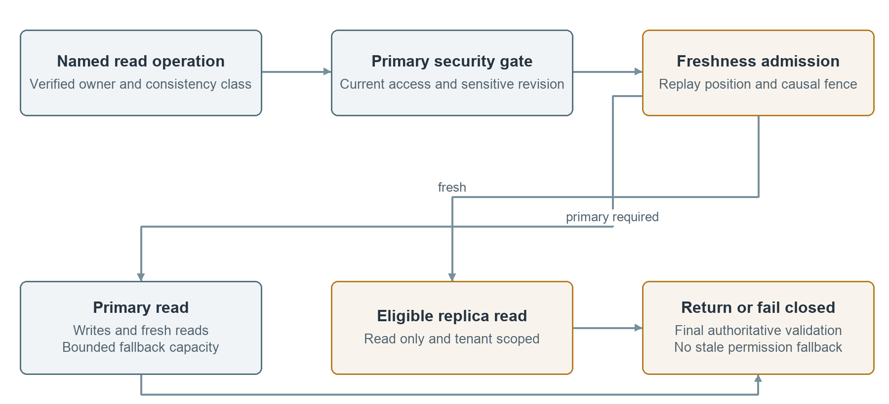
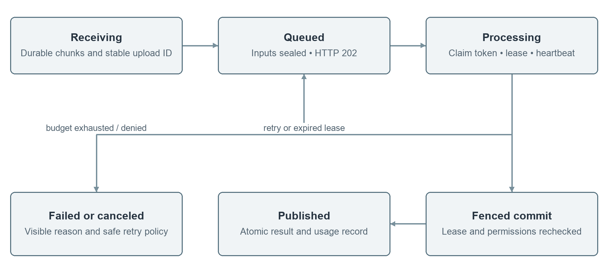

# Stillmark Architecture Design

Architecture review edition • 27 October 2026 • Revision 2.0

> **Target-state design — not the deployed system.** This document describes where the
> architecture is designed to go. Application cells, PostgreSQL read replicas, owner-based sharding and tenant movement are **not built**; see [what exists today](#what-exists-today).
> The system that exists today is described in [the current architecture](../ARCHITECTURE.md)
> and [production operations](../PRODUCTION.md).

## What exists today

| Design element                                             | Status today                                                        |
| ---------------------------------------------------------- | ------------------------------------------------------------------- |
| Gateway identity, row-level security, transaction identity | Built and in production                                             |
| Separate upload pool, durable queue, leases and fencing    | Built and in production (one node, automatic scale-out disabled)    |
| Finite face, search and video batch workers                | Built and in production                                             |
| Lease-elected background coordinator                       | Built and in production                                             |
| Automatic upload scale-out                                 | Built and tested in an isolated environment; disabled in production |
| Load harness for capacity measurement                      | Built; the one-million-user envelope has not been measured          |
| PostgreSQL read replicas                                   | Not built                                                           |
| Owner-based database sharding and shard provisioning       | Not built                                                           |
| Multiple application cells and tenant movement             | Not built                                                           |
| Partitioned Cortex Search services                         | Not built; one search service today                                 |

Present-tense statements below describe the intended end state, not current behaviour,
unless a source reference shows the mechanism in this repository.

Stillmark is a private media platform with an end-state architecture designed around one million registered users and 100,000 concurrently active users. It separates interactive browsing, upload transfer, durable media processing, and asynchronous enrichment into independently controlled workloads. Repeatable application cells distribute application, database, storage, search, and processing capacity.

This specification describes the completed system design, including PostgreSQL read replicas, owner-based database sharding, automated finite batches, and code-level reliability controls. Capacity is governed by workload rates, data volumes, service objectives, and validated resource profiles.

## Architecture position

Snowflake App Runtime hosts stateless application services. Snowpark Container Services compute pools host upload and batch workers. Snowflake Postgres stores transactional catalogs, permissions, queues, and state. Internal Snowflake stages store media. Cortex REST supplies description inference, and partitioned Cortex Search services provide semantic retrieval. Cloudflare and Auth0 form the edge and identity boundary. CARTO supplies map tiles.

## Design principles

Each owning library has one authoritative cell and transactional boundary. Read replicas serve explicitly eligible reads while the primary establishes mutable authorization. Durable queues separate upload transfer from processing. Independently scaled workload pools preserve interactive capacity. Versioned publication, leases, and operation identifiers preserve correctness across retries and instance replacement.

## Review scope

The document covers service composition, identity and permissions, ownership and data contracts, database reads and writes, media delivery, asynchronous work, automatic scaling, recovery, operational telemetry, capacity modeling, and release assurance. Source references connect the architecture to its implementation mechanisms and verification suites.

# 01 Design objectives and constraints

The platform must remain economical for one owner while exposing configuration and isolation boundaries suitable for a much larger deployment. Upload bytes and processing use a dedicated compute pool that suspends when idle. Larger deployments use multiple cells with measured capacity limits.

| Requirement         | Design contract                                                                                                                                                           |
| ------------------- | ------------------------------------------------------------------------------------------------------------------------------------------------------------------------- |
| User scale          | Design envelope of one million registered accounts and 100,000 concurrently active users.                                                                                 |
| Media footprint     | Capacity model of 10,000 photos and 1,000 videos per user, with observed distributions and growth guiding allocation.                                                     |
| Storage boundary    | Original media and derived assets remain in internal Snowflake storage. No external media bucket is assumed.                                                              |
| Interactive compute | Browsing, admission, status reads, and queue orchestration must not resume a SQL warehouse.                                                                               |
| Real processing     | Explicit index publication and other approved SQL processing can use bounded warehouse work with attribution.                                                             |
| Batch operation     | Face scanning, video processing, OCR and visual enrichment, and search publication remain finite jobs, automatically scheduled by count, age, prerequisites, and budgets. |
| Access control      | Owner/library scope, explicit shares, public-link capabilities, and administrator privileges remain enforced across every route.                                          |
| Scale controls      | Autoscaling uses validated failure-recovery and scale-out profiles; expensive growth always has ceilings.                                                                 |

## Nonnegotiable invariants

An accepted upload has durable inputs and a durable processing record. A published media item has one authoritative catalog identity. A stale worker cannot publish after its lease has been replaced. Missing identity and ambiguous authorization fail closed. A read replica, cached search result, or signed media locator cannot grant access on its own.

Reads must never initiate an enrichment batch merely because a user opened an activity page. Search may index available metadata before optional enrichment finishes, but completion status must identify which revision and which stage are complete. Retrying an operation must not double-count its publication or silently repeat a chargeable AI request with an unknown outcome.

## Capacity governance

Capacity allocation uses sustained throughput, latency, storage, recovery, and provider quotas. End-user authentication, browsing, upload transfer, and processing are independently measured workload dimensions. Resource ceilings are configured for the account and region.

# 02 System context and trust boundaries

Figure 1. System context. Owner placement routes traffic to independent cells with their own application, database, storage, search, and processing capacity.

## Boundary responsibilities

The browser holds a user session and local transfer progress. It does not hold database credentials, decide the authoritative media owner, or determine its destination shard. Cloudflare validates the external session and forwards tightly scoped, signed identity to an approved origin. The application verifies that envelope and resolves current permissions before reading metadata or issuing an upload capability.

Auth0 is the external identity provider. The application maps its immutable subject to internal identity and library memberships. Account provisioning, session renewal, logout, and revocation must be independently observable. A valid identity token is not blanket authorization to an album.

The routing directory is a control-plane service: it maps a library owner to a cell and routing epoch. It stores placement metadata, not photos. The cell owns the request’s transactional boundary. Requests involving shared albums resolve the album owner’s cell; the viewer’s home cell is not necessarily the data’s location.

Snowflake contains the transactional and processing data plane. Cloudflare and Auth0 remain external dependencies even though the media infrastructure is in Snowflake. Account-level limits, regional failures, and provider control planes can still affect multiple cells simultaneously.

# 03 Repeatable application cell

Figure 2. One application cell. Repeat this unit rather than increasing a single global pool indefinitely. Optional read replicas are separate from the primary’s HA standby.

| Component                    | Ownership and scaling boundary                                                                                         |
| ---------------------------- | ---------------------------------------------------------------------------------------------------------------------- |
| App Runtime group            | Stateless API and UI requests; bounded process-local caches and database pools; independent deployable service groups. |
| Upload ingress and consumers | Dedicated CPU service for bytes and durable work; receiver-only and consumer-only roles scale with their workload.     |
| Postgres primary             | Catalog writes, authorization, upload acceptance and publication, leases, outbox, and current state.                   |
| Read replicas                | Explicitly eligible read models and reporting; freshness admission and primary authorization remain mandatory.         |
| Internal stages              | Durable originals, immutable derivatives, staged chunks, and model assets; paths include cell and owner scope.         |
| Batch pools                  | Separate face CPU, search CPU, and video GPU capacity; finite jobs and workload-specific admission.                    |
| Search services              | Owner-aware partitions with a directory; publish revisions, query filters, and authoritative result checks.            |

A cell has a maximum sustainable workload envelope and an operational reserve. The control plane places new owners in cells with sufficient CPU, connection, storage, queue, search, and budget headroom. It does not move existing owners simply because a single short burst occurs.

App Runtime supports at most ten instances per application service [S1]. Larger deployments need multiple services/cells and validated account capacity. User counts alone do not establish throughput; physical placement and shared dependencies must be measured.

# 04 Domain ownership and data contracts

The routing unit is an immutable library or tenant identity representing the owner’s media domain. A login can belong to several libraries. Display names and usernames are presentation attributes; they must not become permanent shard keys. Shared viewing does not copy ownership into the viewer’s catalog.

| Entity                    | Authoritative location and contract                                                                                    |
| ------------------------- | ---------------------------------------------------------------------------------------------------------------------- |
| Identity mapping          | Trusted control plane maps Auth0 subject to internal principal; credential material is not copied to work queues.      |
| Library placement         | Directory record contains library ID, cell ID, endpoint set, routing epoch, schema compatibility, and lifecycle state. |
| Album and media           | Owner shard; identifiers are globally unambiguous or explicitly cell-qualified.                                        |
| Share grant               | Owning library’s authority; recipient directories are discovery hints, never the permission source.                    |
| Upload session and job    | Same shard as the destination album, allowing atomic publication and completion accounting.                            |
| Face identity and matches | Library-scoped identity, confirmation/ignore state, consent, model revision, and provenance.                           |
| Search document           | Derived projection with owner, media ID, content revision, and deletion/access metadata.                               |
| Usage event               | Immutable operation identity and purpose; aggregate summaries can be eventually consistent.                            |

## Durable identifiers

Globally stable public media identifiers preserve ownership and precision across the fleet. API serialization preserves the full identifier domain. Compatibility mappings retain existing album links, share links, jobs, search documents, and stage paths. Foreign keys, cursors, arrays, cache keys, and worker payloads follow the same versioned identifier contract.

## Versioned boundaries

Upload protocol version, payload schema, model version, search-document revision, and routing epoch are separate fields. Workers reject unsupported protocol versions explicitly. Rolling deployments support the previous compatible client protocol until old browser sessions expire. A media object’s stable identity must survive movement between cells; internal location is an indirection, not part of a public identifier’s meaning.

Use schema migrations with bounded locks and compatibility notes. Do not infer tenant identity from a caller-provided path, hostname, username string, or unverified queue payload.

# 05 Authentication and authorization

The gateway and application have distinct responsibilities. The gateway validates session authenticity and signs the origin envelope. The application verifies the envelope, maps the identity, checks revocation and library scope, and establishes transaction-local database context. A service credential identifies a backend; it does not replace end-user authorization.

## Established code boundaries

`lib/identity/auth.ts`, `lib/identity/gateway-auth.ts`, and `lib/identity/auth-state.ts` implement authentication and session-state handling. `lib/postgres.ts` establishes database identity within transactions, clears it through commit or rollback, and destroys a connection if rollback fails. Catalog RLS and live album checks provide a second boundary. Maintenance and queue credentials are separate; the web role must not fall back to an administrative credential after an error.

`lib/media/media-lookup.ts` first attempts ordinary visibility using the verified principal and non-elevated flags. Only a miss takes the separate verified administrator path. `photo_security.lookup_media` is SECURITY INVOKER. This reduces unnecessary privileged-role resolution without declaring every authenticated request an administrator.

## Fleet authorization

Cache bounded identity and role facts only under a defined revocation contract. Keys include principal, tenant, credential/session generation, and authorization version. No cached storage URL, replica row, or search hit is sufficient proof of access. Keep expensive authentication outside a database checkout so a slow identity provider cannot occupy catalog connections.

Library and principal authorization epochs scope ordinary invalidation, while a global mechanism supports emergency revocation. Cache keys and delegated work carry the relevant epoch so permission changes invalidate the appropriate scope.

## Adversarial acceptance

Exercise missing identity, forged headers, wrong owner, revoked shares, expired public links, reused pooled connections, disabled users, stale routing, and read-only administrator writes. Denial must occur before metadata or bytes leave the trusted service. Record denial categories without logging tokens, signed URLs, face labels, GPS, or user search text.

# 06 Browsing and media request flow

A collection request authenticates once, resolves the relevant library placement, obtains a bounded page of eligible albums, and returns a stable cursor. Album requests fetch one keyset page using an indexed owner/album path. Counts use maintained summaries where exact real-time aggregation is unnecessary. Avoid synchronous scans, per-photo role lookups, and unbounded parallel downstream calls.

## Request sequence

1. Validate the session and request ID at the edge. Enforce body, rate, and concurrency limits appropriate to the operation.
2. Resolve the owner’s cell from a trusted directory cache and validate the routing epoch at the destination.
3. Establish current authorization on the primary. Choose the read class described in the next sections.
4. Fetch a bounded result page from the eligible primary or replica route. Batch final visibility checks rather than issuing one query per result.
5. Return metadata with content revision and cursor. Media requests separately authorize the requested immutable rendition before streaming bytes.
6. End database work before streaming. Cancel upstream transfer when the client disconnects; preserve valid range semantics for video.

## Primary and replica selection

The query layer exposes named operations such as `readAlbumPage`, `readMediaMetadata`, and `readCostSummary`, each declaring consistency and sensitivity. It does not route arbitrary SQL based on whether the first word is SELECT. Some SELECT functions mutate state, and a read can still be security-critical.

Primary-only examples include permission bootstrap, public-link validation, session revocation, upload status, queue claims, mutations, immediate read-after-write, and permission-sensitive search validation. Replica candidates include established album listings, immutable rendition metadata, cached cost history, and precomputed location summaries, only under the freshness and authoritative-access contract.

A replica failure does not authorize unlimited fallback to the primary. Apply a reserved primary read budget and shed or defer nonessential reporting. Interactive requests receive a bounded failure with a correlation ID if neither safe path is available.

# 07 PostgreSQL read replica architecture

Read replicas provide independently sized capacity for eligible reads. The primary handles writes and mutable authorization, while replica routing applies operation-specific consistency and sensitivity rules. The capacity model includes both replica reads and the associated primary authorization work.

Snowflake documents read-only replicas with independently selectable compute, the same storage size as their leader, replicated credentials, and inherited network rules [S2]. Model freshness as asynchronous and measure replay lag. A readable replica is not the same service as the primary’s HA standby [S3]. No automatic promotion of an arbitrary read replica is assumed.

| Read class                              | Read route                                   | Protection                                                                                |
| --------------------------------------- | -------------------------------------------- | ----------------------------------------------------------------------------------------- |
| Permissions and revocation              | Primary                                      | No stale-positive authorization.                                                          |
| Upload state and mutation follow-up     | Primary or causal-safe replica               | Read-your-write fence and explicit deadline.                                              |
| Album and collection page               | Eligible replica                             | Primary establishes and revalidates visible IDs; tenant and ACL scope enforced.           |
| Photo details                           | Eligible replica only if sensitivity permits | Revision fence for redactions, location/name visibility, and deletion; otherwise primary. |
| Cost history and aggregates             | Replica                                      | Timestamp/as-of label; no refresh job initiated by reading.                               |
| Lease claims and job status transitions | Primary                                      | Row locks, fencing token, authoritative state.                                            |
| Public share validation                 | Primary                                      | Expiry, revocation, scope, owner, and download permissions.                               |

## Isolation and connection design

Use separately named primary, replica, queue, and maintenance pools. Give replicas read-only application grants and transaction settings; verify equivalent RLS policies after replication. Secrets remain scoped to the cell. Allowlist approved replica hosts and verify TLS certificates. Do not let a browser choose the database endpoint.

Set maximum replica query duration and result size. Long standby queries can conflict with recovery or worsen replay lag; cancellation must return a retryable read error without hiding the condition. Track canceled reads, WAL retention, replay delay, primary write latency, and replica storage growth together. Adding replicas consumes compute, storage, and potentially transfer charges [S4].

# 08 Replica consistency and safe fallback

Figure 3. Read-routing decision. A freshness check is not a substitute for an access check.

## Causal reads

After a committed write, return an opaque consistency token bound to the library, routing epoch, and a verified commit position or equivalent revision. An implementation may obtain a WAL position after commit; do not label a position sampled before commit as a commit fence. The router sends a causal read only to a replica that has replayed at least that position, within a short bounded wait. Otherwise use the primary. The selected mechanism is validated against the configured Postgres privileges and replication behavior.

The primary-pinning route directs the user’s post-write reads to the primary. A fixed time window alone is not proof of catch-up; expiration requires a verified revision or continued primary routing. Tokens cannot be forged to select arbitrary endpoints. Primary generation and routing epoch invalidate old tokens after failover or shard movement.

## Revocation and sensitive edits

Fetch candidates in a constrained replica snapshot, then perform a batched primary check before returning any sensitive metadata. Deleted, revoked, or stale-sensitive records are removed or refreshed from the primary. A redacted caption, removed GPS value, changed face name, or shortened public share scope cannot be served from an older replica revision just because the viewer still has album access.

If the primary cannot validate access, fail closed. Do not serve stale positive ACL decisions to preserve availability. Already downloaded bytes cannot be recalled; document that distinction in public sharing. Public access, narrow share subsets, and security-sensitive detail reads remain primary-only.

## Admission thresholds

Maximum lag is configured separately for ordinary browsing and reporting, with example policy values of one second and sixty seconds respectively. Freshness requires both a healthy replication signal and suitable data revision; an idle primary makes timestamp-only lag calculations misleading. Test stalled replication, missing telemetry, replica restarts, primary failover, and revocation during a replica query before enabling production routing.

# 09 Transactional model and query efficiency

Each owner’s catalog, active upload jobs, and publication outbox reside on one shard so publication can use a single local transaction. Shared-library discovery may span cells, but there is no synchronous distributed transaction for an album page. Data fetched from another cell remains governed by that owner’s authority.

## Access patterns

Define indexes from actual predicates and ordering: library plus album and stable media sort key; library plus upload state and next-attempt time; library plus revision for outbox consumption; and indexed stage/rendition path lookups. Keyset pagination includes a unique tiebreaker. Avoid OFFSET growth, full-library counts per request, global locks, and rebuilding an accessible-album set for every thumbnail.

Use tenant keys in both indexes and join predicates. Partition append-only activity, usage, and history tables when retention and measured query patterns justify it. Partitioning is not a substitute for an index or for explicit tenant scoping. Large face and vector data may require separate physical structures while retaining authoritative identity and publication contracts.

## Query optimizations

The indexed photo policies use an indexed parent-album lookup rather than materializing all readable albums per photo. The media lookup function reduces repeated request/database round trips while retaining RLS. Role-cache cleanup uses nonblocking row selection to prevent many concurrent requests from contending on the same expired rows. The owner album sort index supports bounded listing paths.

These changes are backed by migrations `202610260230`, `202610270130`, `202610270330`, `202610270400`, and `202610270410`.

## Transaction discipline

Keep transformations, network calls, inference, and media streaming outside transactions. Lock only the owner/session or album needed for the mutation. Reserve independent capacity for durable cleanup intents that must survive a parent transaction rollback. Order locks consistently and test concurrent share edits, deletion, duplicate uploads, and worker recovery. Lock scope preserves each safety invariant while isolating independent owners and operations.

# 10 Connection budgets and pooling

Concurrency is a budget across the entire cell. A process-local pool limit multiplied by app instances, worker instances, service roles, direct connections, replicas, and deployment overlap can exhaust a small database even when individual SQL execution is fast.

**Budget equation.** Primary backend demand equals all direct connections plus the sum of permitted PgBouncer server connections for every database/role pair, plus administration, replication, and failover reserve. Count rolling-deployment overlap and independent durable-write pools. Replica budgets are separate but their replication work still affects the primary.

Snowflake exposes PgBouncer on port 5431; direct Postgres normally uses 5432. Its default mode is transaction pooling [S5]. Transaction-local identity remains isolated across pooled clients; session-sensitive operations retain dedicated connection routes.

| Work type                     | Connection treatment                                                                                       |
| ----------------------------- | ---------------------------------------------------------------------------------------------------------- |
| Short catalog transactions    | PgBouncer candidate after identity and timeout verification.                                               |
| Transaction-local RLS         | Configure identity inside each transaction; verify clearing on success and rollback.                       |
| Session advisory locks        | Direct or dedicated session-pooling route; never rely on a transaction-pooled session across transactions. |
| Independent durable intents   | Separate bounded route to prevent waiting behind parent transactions occupying the same capacity.          |
| Migrations and administration | Separate tightly bounded direct connection.                                                                |
| Batch jobs                    | Workload-specific role and cap; reserve capacity for interactive traffic.                                  |

`lib/database/postgres-pool-budget.ts` defines configurable per-process limits; `lib/upload/upload-queue-database.ts` owns a restricted queue pool. The router must not eagerly connect every app replica to every shard. Use bounded lazy pools per active cell, idle eviction, endpoint generation keys, and an overall process cap. A stale pool is drained after routing changes.

Resolve external authentication before checkout. Measure acquisition wait separately from SQL execution and connection creation. Bound waiting requests; a large connection queue is latency, not free capacity. Do not increase pool sizes simply because CPU is low. Compare wait, active backend count, lock waits, memory, and throughput under a fixed workload before changing limits.

# 11 Upload admission and transfer

The upload path separates browser transfer from server processing. The application authorizes a destination and returns a scoped upload session. Media chunks go through the approved gateway to the upload receiver and into internal stage storage. Completion seals verified inputs and durably enqueues processing. Returning HTTP 202 means acceptance, not successful publication or completed AI enrichment.

## End to end protocol

1. Validate identity, album ownership/share policy, available quota, file constraints, and routing epoch. Assign an immutable upload UUID and idempotency scope.
2. Transfer numbered immutable chunks. Record lengths, hashes, stage references, and receipt state; reject conflicting replays. Bound memory, open streams, bytes in flight, and incomplete session counts.
3. Seal completion only after the declared chunk count and total size agree with accepted inputs. Freeze metadata and persist the job in the owner shard. The queue stores references, not image bytes or browser credentials.
4. Return a durable job identifier. The browser releases its transfer slot and starts the next file while accepted jobs process independently.
5. Poll batched owned IDs or use an authenticated status channel with bounded reconnect behavior. Closing the browser does not cancel accepted work; unsent local bytes still require the client.
6. Publish the original, derivatives, catalog result, usage event, and downstream intent under the fenced completion contract. Show processing and publication as separate states.

## Client and service coordination

The queued client supports four transfer slots independently of processing slots, recovered job IDs, per-file progress, retry, and explicit access errors. Receiver and worker concurrency are distinct controls. `lib/upload/upload-client.ts` handles transport; `lib/upload/upload-processing-jobs.ts` seals and enqueues; `lib/upload/upload-queue.ts` manages browser orchestration.

At large scale, enforce fair admission by tenant, bytes, and workload cost rather than only file count. Return a documented retry time when capacity is unavailable. Admission must not resume a SQL warehouse. A short warm ingress path avoids GPU-style startup delays. Small personal installations can route consumers back to the app; this is an operating mode, not the million-user topology.

# 12 Durable processing and publication

Figure 4. Durable upload lifecycle. Retrying work is allowed; duplicate publication is not.

## State and ownership

`lib/upload/upload-processing-policy.ts` selects queued work or expired leases using `FOR UPDATE SKIP LOCKED`. Claims increment the attempt count, assign a unique token, and set a five-minute lease. `lib/upload/upload-processing-worker.ts` renews every thirty seconds without overlapping renewals. A renewal exception does not imply continued ownership.

The worker verifies accepted delegation age, current authorization epoch, owner identity, and permissions. Transformations happen outside the publication transaction. At commit, `lib/upload/upload-completion-claim.ts` rechecks both the processing lease and completion lease, current authorization, and existing result. A replacement queue claim can replace its predecessor’s independent completion lease rather than consuming retries waiting for the old timer.

The catalog result, completion state, and upload accounting commit together. Cleanup becomes eligible only after the required durable references are no longer needed. A lost HTTP acknowledgment is resolved by checking the same upload UUID, not creating another photo. Preparation and storage attempts may repeat; the guarantee is idempotent publication, not exactly-once execution of every side effect.

## Cancellation and drainage

Browser Cancel stops future local transfers. Accepted jobs continue as described by the UI; dismissal of an unfinished session fences its job. Successful photos remain. A process shutdown stops new claims and lets active work finish or recover by lease expiry. An instance must not accept a new claim after entering drain mode.

The job state machine provides explicit terminal cancellation semantics for queued and processing jobs, where cancellation and publication race under the same authoritative lock. It must never claim that an already committed photo was canceled. Test cancellation during acceptance, storage write, lease renewal, and transaction commit.

# 13 Retry policy and failed attempt handling

Retry behavior is operation-specific. A timeout does not prove the remote action failed. Preserve a stable operation ID, record whether dispatch occurred, and reconcile uncertain outcomes before replaying writes or paid inference.

| Path                          | Attempt policy                                                                                                                                                      | Reliability control                                                                                                                |
| ----------------------------- | ------------------------------------------------------------------------------------------------------------------------------------------------------------------- | ---------------------------------------------------------------------------------------------------------------------------------- |
| Browser upload request        | Default four attempts. Exponential delay starts at one second; 429 respects Retry-After within a bounded delay. 401/403 stop retries and identify the access issue. | Jitter and an end-to-end retry budget; retain protocol-level idempotency and distinguish renewed credentials from repeated denial. |
| Queued upload processing      | Up to five processing attempts; retry generic failures and HTTP 408, 409, 425, 429, 500, 502, 503, 504. Delay is min(300, 5 × 2^attempts) seconds.                  | Structured error taxonomy, tenant-level retry budgets, randomized backoff, and a reviewed dead-letter workflow.                    |
| Interrupted worker            | Expired leases become claimable; excessive interruptions become a visible failure.                                                                                  | Test whole-node loss, repeated loss, heartbeat partition, and stale publication across every supported node family.                |
| Media fetch                   | One retry for selected socket failures before headers; no replay after response streaming starts.                                                                   | Track delivery completion and disconnect reason; apply verified cache and circuit controls.                                        |
| Snowflake role acquisition    | One narrowly classified transient login retry within the acquisition budget. Authentication denial is not retried.                                                  | Preserve bounded retries across SDK changes; correlate external call failures without exposing credentials.                        |
| AI or other external mutation | A durable job does not guarantee provider exactly-once execution.                                                                                                   | Persist provider request ID and attempt outcome; reconcile before another chargeable request when the response is lost.            |

## Operational treatment

A failed upload retains a user-visible reason and the durable references needed for a permitted retry until retention expires. Manual retry rechecks authorization and prerequisites; it must not merely change a row back to queued. Terminal failures remain in the job table and are exposed through a fleet-wide failed-work console with controlled replay and a common error taxonomy.

Record attempt ID, job ID, worker instance, claim token generation, start/end, category, next attempt, and terminal decision. Log safe error codes rather than raw provider payloads. Aggregate retries by root dependency so an outage does not create one independent retry storm per file.

# 14 Timeouts and connection failure safety

Timeout layers need distinct names and budgets. DNS/TLS/connect time, pool acquisition, server queueing, query execution, response headers, and streamed body completion are not the same measurement. Preserve the original deadline through nested helpers rather than restarting it at every retry.

## Code contracts

`lib/connection-deadline.ts` bounds acquisition. If a connection arrives after the caller timed out, it is returned without executing abandoned work. Work failures destroy the affected connection rather than returning it for reuse.

`lib/snowflake/snowflake-query-deadline.ts` uses an abortable transport context for the dedicated authorization query. The pinned SDK patch in `scripts/snowflake-deadline/` interrupts HTTP and backoff waits, validates exact source hashes, and fails installation on drift. A failed role connection has separately bounded destruction. The documented budget is up to five seconds acquisition, ten seconds query, and two seconds cleanup, subject to scheduling; this is not a ten-second whole-request SLO.

`lib/media/media-fetch.ts` bounds time to response headers at thirty seconds and propagates caller abort. A healthy long video stream is not cut off by that header timer. The helper retries only selected reset/socket errors before headers. HTTP denials, user cancellation, and failures after bytes begin are not transparently replayed.

`lib/postgres.ts` uses transaction-local identity and rollback; rollback failure destroys the connection. App and queue query/statement timeouts are separate. These implementation ceilings are safety bounds, not acceptable normal browsing latency.

## Failure behavior

Use one monotonic request deadline and a bounded cleanup allowance. Return 429 for admission pressure and an appropriate transient response for a dependency outage; do not turn every failure into an authentication prompt. Reserve 401 for a genuinely missing/expired session and 403 for verified denial. Client messages must distinguish upload transfer, queued processing, and downstream enrichment.

Dependency-specific circuit breakers use a tested recovery probe and strict scope. Never cache a positive permission because the authorization dependency is unavailable. Never retry a catalog mutation simply because a socket closed after dispatch. Record whether failure occurred before application arrival, inside the handler, during streaming, or at the client.

# 15 Worker capacity and automatic scaling

App scaling, worker scaling, and compute-pool node scaling are separate control loops. App Runtime’s CPU-based instance scaling does not directly measure backlog age. SPCS service instances request CPU and memory; pool nodes provide schedulable capacity. More replicas can still contend on one node unless actual placement is verified [S1, S6].

## Scaling controller

A durable controller samples queue depth, oldest eligible age, arrival rate, measured service rate, CPU, memory, database waits, storage latency, retry rate, and provider quota pressure. It computes a desired consumer count within per-cell and account ceilings. A leader lease and generation prevent conflicting controllers. Control decisions and cooldown state survive restarts.

Required consumers are approximately arrival rate divided by measured sustained throughput per consumer, adjusted for headroom and backlog-drain objectives. This estimate is bounded by database connections, memory, stage traffic, and external API limits. It must not increase workers when failures come from a saturated dependency.

## Scale actions

Scale up when sustained queue pressure exceeds the objective and dependencies have headroom. Use conservative step sizes and measure readiness before admitting additional work. Scale down more slowly, stop claims, drain active jobs, then reduce service instances; allow pool nodes to settle. Burst tolerance and an idle cushion are configurable. Do not use node status alone as proof of useful workers or billing cessation.

A larger node does not automatically make a container use all its CPU. Regenerate requests/limits, runtime CPU/memory budgets, thread counts, and processing slots from a validated node profile. Benchmark representative JPEG, HEIC, large image, and video metadata cases. Oversubscription can increase memory pressure and latency even while aggregate CPU rises.

`lib/upload/upload-dispatcher.ts` provides one bounded dispatcher per replica. `lib/upload/upload-routing-control.ts` and related admission code coordinate dedicated-pool startup, admission and idle suspension. Fleet-wide scheduling coordinates tenant fairness and dependency-aware scaling. Recovery, scale-up, scale-down, and simultaneous workload validation govern each enabled profile. Forecasting prewarms capacity while reactive safeguards maintain the same resource ceilings.

# 16 Automated finite batch processing

The end state automates batch scheduling while keeping work finite and isolated from interactive reads. A batch starts when enough eligible work accumulates or the oldest eligible item exceeds its maximum wait. A threshold such as 1,000 photos is an example policy, not a fixed requirement for all workloads. Low-volume users must not wait indefinitely.

| Workload           | Eligible input                                                  | Completion and dependency                                                                                 |
| ------------------ | --------------------------------------------------------------- | --------------------------------------------------------------------------------------------------------- |
| Face scan          | Published image, valid consent, missing required model revision | Store detections and proposed/confirmed identity state; enqueue search revision changes.                  |
| Search enrichment  | Published image missing OCR or visual feature version           | Store text, confidence, embeddings, provenance; mark affected search documents dirty.                     |
| Video processing   | Durable supported original and required rendition profile       | Produce verified playback artifacts; commit rendition pointers; retire obsolete artifacts safely.         |
| Search publication | Coalesced dirty document revisions or tombstones                | Publish available authorized fields and record indexed revision; acknowledge only the published revision. |
| Saved ranking      | Eligible saved query and changed candidate/model revision       | Persist bounded private ranking; never invent results for future unseen queries.                          |
| Storage cleanup    | Expired or retired objects with no protected references         | Delete bounded manifests and reconcile outcomes; never scan all live media on every poll.                 |

## Dependency graph

Publication of the original unlocks description generation, eligible face work, and OCR/visual work. They may run independently, with separately budgeted resource use. Search publication can publish a useful partial document, then coalesce later updates. It must not recursively start another enrichment job. Video playback readiness is separate from upload acceptance and photo search readiness.

Each job has a snapshot boundary, input revision, model/configuration hash, resource budget, claim lease, and maximum runtime. Admins retain Run now, Pause scheduling, Cancel, and Retry failed controls. Status reads report pending, starting, running, follow-up publication, retrying, failed, and done without starting work.

Different pools prevent direct CPU/GPU contention but not shared database, storage, API, or index contention. Reserve interactive capacity and test concurrent batches. GPU startup time is amortized through meaningful finite batches; the design does not rely on rapid GPU suspend/resume for live queries. Automatic policy scheduling and explicit administrator controls use the same finite-job lifecycle.

# 17 AI descriptions and model operations

Photo description generation uses a durable operation tied to the media revision, prompt version, and model. The reviewed code in `lib/ai-categorize.ts` selects `claude-sonnet-4-6`; the architecture treats this as configurable model policy rather than a permanent platform dependency. Use the direct Cortex REST path where supported and authorized, not a general agent wrapper for a single description request.

## Input and output contract

Generate a bounded derivative appropriate for vision inference. Keep original media unchanged. Record the exact model, prompt/schema version, image revision, provider request ID, input/output tokens, result status, latency, and attributed cost. The response is validated against a schema before committing fields; malformed JSON is a failed attempt with a safe diagnostic, not partially trusted metadata.

AI descriptions are evidence about visible content, not authoritative identity, date, GPS, or ownership. EXIF and user edits retain provenance. Reprocessing is explicit and versioned; a model upgrade must not automatically regenerate the entire corpus. Reuse requires compatible content, privacy scope, prompt, model, and revision policy.

## Quotas and failure recovery

Separate admission from provider dispatch. Enforce account/model/region rate and token budgets, per-tenant spend policy, and bounded concurrent calls. When the provider throttles, defer jobs with backoff instead of occupying a worker in a tight retry loop. A network timeout after dispatch is an unknown outcome; preserve the attempt and reconcile when provider data allows. Do not claim the internal job ID makes the external API exactly once.

Store the result even if a secondary cost reconciliation process is delayed, using a durable accounting intent so successful inference is not repeated only to repair a ledger. Accounting failure must remain visible. Result publication and durable accounting intent have an explicit transactional boundary.

## Quality gates

Maintain a reviewed set covering landmarks, small text, menus, race numbers, multiple people, low light, and ambiguous scenes. Compare factual precision and useful recall alongside cost per image and end-to-end latency. Exact names and identifiers used as filters must not be inferred solely from a fluent model description. Pin model assets for local OCR/embedding jobs and validate compatibility between offline image and live text encoders.

# 18 Search architecture and correctness

The foundation is permission-scoped text and semantic retrieval over descriptions, captions, tags, OCR evidence, album metadata, dates, location fields, and confirmed people relationships. Distinguish structured facts from extracted evidence. An ignored or unconfirmed face cannot establish a confirmed-person match. Equivalent visible person names may form alternatives without merging the underlying owners’ identity records.

## Query execution

Basic scene and keyword searches use the established retrieval path without an LLM. Deterministic parsing handles supported people, date, location, and identifier expressions. Only unresolved logic may invoke a bounded intent parser; its output is validated into a constrained query representation, never executed as arbitrary SQL. Unsupported ambiguity produces clarification or a clearly labeled broad result.

Apply exact requirements before relevance ordering. Semantic or visual similarity cannot let a number-57 rider outrank an eligible confirmed number-6 match by ignoring the requested identifier. Preserve all required person groups and date filters across pagination. “Keith and Raul together” intersects person groups at the photo level; two records for Keith are alternatives within Keith’s group.

Cortex Search provides managed hybrid retrieval and runs with owner’s rights [S7]. Service access does not inherit the viewer’s Postgres RLS automatically. Route only to eligible partitions, supply trusted scope filters, and reauthorize result IDs on the owner primary before returning metadata. Private face names require a privacy-preserving owner-scoped projection or separate authorized join, not a globally searchable shared field.

## Optional enrichment and ranking

The search worker uses OCR, CLIP image features, and a cross-encoder. Visual retrieval and saved ranking are controlled through workload configuration and relevance gates. Visual evidence supports retrieval/ranking without overriding hard requirements. Saved-query batch reranking improves an already known query/candidate set; it cannot precompute every future phrase. First searches still need an online baseline.

Partition by bounded owner groups and measured document volume, query rate, and rebuild time. Search partitioning is independent of Postgres physical placement but shares directory metadata. Do not design around an unverified 400-million-row allowance. Confirm actual service limits, vector/model options, and quotas before selecting partition sizes. Use revisioned publication, tombstones, stable cursors, and bounded cross-partition fan-out.

# 19 Media delivery and storage lifecycle

Internal stages hold immutable originals and versioned derivatives. Postgres holds authoritative pointers, checksums, revisions, and ownership. Database rows should not contain binary media. Upload acceptance verifies durable references; publication does not expose partially generated assets. A reconciler handles storage objects whose metadata transaction failed.

## Delivery contract

Authorize every private media request or issue a tightly scoped, short-lived capability with an explicitly accepted revocation window. Do not cache private bytes under a URL that lacks user/access scope. Cache keys include object/rendition revision and authorization context where required. Negative permission responses must not leak one user’s state into another user’s cache.

The media delivery path avoids unnecessary full-image byte relay through interactive app instances. The gateway obtains a live authorization decision and delivers approved internal-stage media under controlled signing, expiry, range, and cache semantics. The application streaming path and `lib/media/media-fetch.ts` provide an authorized fallback.

For video, preserve byte ranges, content length/type, partial response codes, cancellation, and rendition readiness. A broken stream is not safely retried after bytes have been emitted. Instrument time to first byte and stream completion separately.

## Cleanup and deletion

Use durable deletion intents and bounded manifests for known retired paths. Protect active upload inputs, retained retries, published originals, and current rendition references. Coalesce eligible deletions and reconcile failures. Do not run unbounded LIST/REMOVE loops or one maintenance command per idle tick. A single bulk command can still incur work proportional to objects; no zero-cost claim is made.

Privacy deletion includes originals, derivatives, face features, search documents, saved rankings, public links, caches, and replicas through replicated tombstones. Define retention and recovery exceptions explicitly. Backups and disaster recovery copies require a documented deletion policy.

Maps use derived GPS summaries, owner-scoped location aggregates, and a provider-style configuration. CARTO keys and restrictions follow provider terms; map tiles are not a reason to resume warehouse compute. Strip or restrict GPS in shares according to the live share policy, including metadata and downloadable originals where policy promises it.

# 20 Automatic shard provisioning and placement

Sharding assigns many libraries to each Postgres instance, not one database per user. A routing directory maps immutable owner identity to a cell, shard endpoint set, and generation. The control plane provisions additional capacity through a controlled state machine rather than issuing CREATE from the first overloaded web request.

## Provisioning state machine

**Requested → provisioning → configuring → validating → ready → active → draining → retired.** Persist each transition, operation ID, desired configuration, timestamps, and failure reason. A failed provisioning attempt is resumable and does not become an active route. Separate the provisioner’s administrative identity from runtime data access.

Create the Postgres instance, network allowlists, TLS trust, restricted roles, schema, RLS, pool settings, backup policy, optional HA, and read replicas through a versioned template. Seed only required control data. Validate denial without identity, isolated tenant writes, replica lag/fallback, migrations, health, and restore before marking the shard ready. Provision related search partitions and stage namespaces under independent quotas.

New libraries are placed using available storage, sustained read/write capacity, hot-tenant skew, connection budgets, queued work, region, and cost ceilings. Placement must be idempotent and serialized per library. Store a reservation before assignment so concurrent placement decisions cannot all consume the same apparent headroom.

## Failure handling

If a provisioning API times out, discover the resource by recorded operation identity before trying again. Never create another database simply because the first response was lost. Reconcile orphaned resources, failed secret rotation, incomplete grants, and template-version drift. Define maximum concurrent provisions and a spending limit.

Existing data remains in its current shard until a separate movement workflow is approved. Add capacity ahead of predictable growth; do not expect database creation, replica seeding, or search rebuilds to complete within an HTTP deadline.

## Directory availability

Cache placement with a generation and bounded lifetime, but enforce write fencing at the destination. During a directory outage, existing validated placements may continue under a defined lease policy; new placement and migration stop. A stale caller cannot write to both old and new shards. The directory must have its own HA, recovery, and operational budget rather than becoming an unmeasured global dependency.

# 21 Tenant movement and shared libraries

Moving an owner must preserve IDs, ownership, ACLs, public links, upload state, search revisions, and media references. Copying rows and changing a hostname is insufficient. No cross-shard ACID transaction is assumed.

## Controlled movement

1. Reserve a destination and record a migration ID, source/destination generations, schema versions, and rollback boundary.
2. Copy an owner-scoped consistent snapshot and required dependent rows. Capture subsequent changes using an approved change stream or a bounded maintenance window. Verify that tenant-scoped CDC and every table dependency are supported before promising online movement.
3. Prepare destination stages or reference mappings, search partitions, credentials, and active job ownership. Do not duplicate external AI or video work during the overlap.
4. Fence new source mutations and queue claims. Drain or explicitly transfer active leases; reconcile accepted uploads whose input bytes are still arriving.
5. Apply final changes and compare row counts, checksums, references, grants, tombstones, and outbox watermarks. Verify destination RLS and current authorization.
6. Atomically advance the directory generation. The old source rejects writes under its previous generation. Retain a bounded forwarding/read-only period only where safe.
7. Observe the destination and retire old copies after the approved rollback/retention window. Once destination writes occur, rollback requires reverse reconciliation, not merely flipping the directory back.

## Shared content

A shared album remains in its owner’s cell. The recipient’s discovery index contains a reference and display summary, not permission authority. Removing a share removes discovery asynchronously, but the owner primary rejects access immediately under the normal revocation contract.

Cross-cell collection pages and search use bounded parallel fan-out and stable composite cursors. Revalidate every returned object at its owner. If one cell fails, report partial availability explicitly and preserve pagination semantics; do not claim a complete empty result. Permission-scoped read projections with freshness guarantees bound large discovery fan-out.

An ordinary library remains within one shard and transaction boundary. Large-library placement uses dedicated capacity within the same ownership model. Repartitioning is an explicit data-contract operation.

# 22 Availability and disaster recovery

Read replicas, HA standbys, backups, and sharding solve different problems. A replica adds eligible read capacity. HA addresses a primary-host failure. Backups repair corruption or deletion. Sharding distributes ownership and limits failure scope. None alone guarantees regional disaster recovery.

Snowflake documents HA using a standby in another availability zone with managed failover; applications must reconnect and handle uncertain transactions [S3]. Choose a supported Standard or memory-oriented instance for HA at scale. Cell profiles declare their durability, capacity, and recovery requirements.

| Failure                  | Recovery behavior                                                                                                                          |
| ------------------------ | ------------------------------------------------------------------------------------------------------------------------------------------ |
| App instance loss        | Stateless rerouting; bounded retries; shared durable sessions and jobs; confirm no identity leakage.                                       |
| Upload worker loss       | Lease expiry and fencing; recover accepted jobs; verify one publication and correct accounting.                                            |
| Read replica loss or lag | Remove from routing; bounded primary fallback; shed reporting before saturating writes.                                                    |
| Primary failover         | Drain bad connections, reconnect with jitter, verify generation, reconcile uncertain commits; suspend stale replica routing until checked. |
| Stage/API outage         | Stop unsafe acceptance, preserve durable jobs, bounded backoff; do not mark unavailable media deleted.                                     |
| Search service outage    | Permission-scoped fallback where supported, or explicit unavailable/partial status; no unfiltered results.                                 |
| Cell or region failure   | Isolate routing; activate a separately validated recovery plan; no assumed instant cross-region promotion.                                 |

## Recovery objectives

Service objectives include 99.9% monthly availability for core interactive operations, primary/cell recovery objectives agreed against measured restore and failover times, and an explicitly documented RPO for each data class. Do not promise zero-loss regional recovery without independent storage and database replication evidence.

A useful recovery test restores metadata, permissions, secrets references, stage mappings, model assets, queue generations, and search rebuild inputs. Verify that restored jobs cannot replay already completed external side effects. Recovering a database dump without the media is not application recovery.

`scripts/verify-backup.py` validates a restored database, referential integrity, security functions, and unscoped access denial. Fleet recovery also exercises full-cell restoration, media references, directory state, and regional procedures with measured RTO/RPO and protected backup retention.

# 23 Observability and exact failure attribution

Every slow or failed request should produce an attributable timeline. A request ID must survive the load generator/browser, Cloudflare, origin ingress, application, database operations, storage fetch, and response completion. Preserve a trace parent and operation/job identifiers without putting sensitive payloads into telemetry.

## Required timing spans

Record edge receive/forward, application arrival, event-loop delay, identity validation, role-cache hit/miss, Snowflake connection acquisition, external authorization call, Postgres checkout, query duration, lock/queue waits where observable, media signing, storage response headers, first byte, stream finish, and client completion. Mark retries as child attempts under the same logical operation.

A handler returning a Response object does not prove the browser received the stream. Distinguish app finish, connection close, aborted body, origin reset, edge timeout, and generator timeout. A failed external call can be localized to that boundary even when the provider’s internal cause is unavailable. Label that uncertainty rather than attributing all delay to Postgres or Snowflake broadly.

## Instrumentation

`lib/upload/upload-request-trace.ts` supplies request counters/timings. `lib/load-test-http-lifecycle.ts` provides isolated HTTP lifecycle evidence. The isolated generator correlates request IDs and retains selected latency samples. `lib/upload/upload-queue-metrics.ts` exposes queue measurements. PlatformMonitor is enabled in the upload-worker specification.

The observability layer extends correlation to every production dependency, uses bounded sampling, retains all failures subject to privacy controls, and records p50/p95/p99 by operation and outcome. Avoid unbounded per-user metric labels. Store full IDs in controlled traces, not high-cardinality metric dimensions. Add provider request/query IDs where safe and meaningful.

## Operational dashboards

Separate interactive latency/error budgets, upload transfer/queue/processing latency, batch freshness, replica replay/standby conflicts, primary connection and lock pressure, storage delivery errors, and cost. Admin-only cost refresh is not an end-user workload. Status polling backs off when idle and stops when the page is hidden unless a bounded background subscription is required.

A trace can explain an observed failure; it cannot prove absence of all failure modes. Preserve raw private test evidence, report the first failed request precisely, and compare identical workloads and measurement windows after each fix.

# 24 Capacity model and performance objectives

Capacity planning starts with workload rates and data sizes, not registered-user counts. The following arithmetic uses decimal units and planning assumptions, not measured production consumption. Replication, redundancy, derivatives, indexes, logs, and traffic overhead add to these totals.

| Scenario         | Assumption                                     | Implication                                                        |
| ---------------- | ---------------------------------------------- | ------------------------------------------------------------------ |
| Original photos  | 10 billion × 5 MB                              | 50 PB.                                                             |
| Original videos  | 1 billion × 200 MB                             | 200 PB; duration/codec distribution can change this substantially. |
| Base metadata    | 11 billion × 2 KB                              | 22 TB before indexes, OCR, faces, vectors, history, and replicas.  |
| Photo thumbnails | 10 billion × 100 KB                            | 1 PB additional.                                                   |
| API browsing     | 100,000 active users, one API request per 10 s | 10,000 requests/s.                                                 |
| Media browsing   | Two media requests/s per active user           | 200,000 media requests/s, a separate bandwidth scenario.           |
| Initial import   | Entire original corpus evenly over 90 days     | About 1,415 files/s and 32 GB/s of original bytes.                 |

## Service objectives

For a declared region, catalog size, and warmed workload: metadata API p95 below 250 ms and p99 below 750 ms; thumbnail response-header p95 below 500 ms; 202 upload acceptance p95 below one second after inputs are durably available; no lost accepted jobs, duplicate publications, or authorization leaks. End-user page completion also includes network transfer, rendering, and image decode.

Define service time independently from queue wait. Little’s law relates concurrent in-flight work to throughput times residence time; 100,000 logged-in users do not imply 100,000 database queries executing simultaneously. A 95% browsing/5% uploading persona mix is a starting scenario, not the same as a 95/5 request or byte mix.

Determine users per app instance and owners per database from sustained measurements with headroom. Calculate cells as the maximum required by app throughput, write/read capacity, storage, search, recovery time, and quotas. Do not extrapolate a 5,000-user pass linearly to 100,000. Validate at each plateau, including longer soak periods, larger catalogs, hot owners, cold caches, and provider rate limits.

# 25 Validation and promotion gates

Testing progresses through correctness, one-instance capacity, controlled scale-out, mixed workloads, and failure injection. Keep Auth0 bypass/preauthenticated tests clearly labeled; schedule permitted Auth0 tests separately after confirming tenant-plan and rate-limit policy. A synthetic caller test is not evidence of production login capacity.

| Gate                  | Required evidence                                                                                                                 |
| --------------------- | --------------------------------------------------------------------------------------------------------------------------------- |
| Single app efficiency | Fixed one instance; exact first-failure trace; bounded pools; 250-user pass before 500; no scaling to hide failures.              |
| Sustained capacity    | Fixed worker/database capacity; compare 1, 2, 4, and 8 app instances; separate warmup and steady state.                           |
| User ramp             | 100, 250, 500, 1,000, 5,000, then justified increments; explicit throughput, latency, errors, and queue-growth gates.             |
| Replica safety        | Revocation, redaction, delete, write-followed-by-read, stopped replication, replica loss, and primary failover.                   |
| Recovery              | Lost acknowledgments, killed worker/node, lease race, duplicate completion, canceled upload, retry exhaustion, dependency outage. |
| Automatic scaling     | Burst, sustained ramp, drain, recovery, and scale-down; verify actual placement and downstream budgets.                           |
| Tenant movement       | Two isolated cells; owner migration under writes; generation fence; cross-cell shares and search.                                 |
| AI and batch load     | Real model quotas, cost, latency, and shared dependency contention; separately approved paid load.                                |

## Evidence contract

Each validation record names the workload, catalog size, identities, application instances, workers, database profile, generator topology, warmup, steady-state duration, and artifact versions. Measurements distinguish queue wait, service time, response headers, and body completion.

Accepted upload IDs reconcile to unique publications and terminal states. Cross-library isolation and current permissions are verified under concurrent work. Performance promotion requires every latency, error, recovery, and correctness gate to pass. Distributed generators are introduced when generator capacity becomes the limiting resource.

# 26 Release configuration and operating modes

One source of truth renders environment-specific manifests, worker specifications, and gateway settings. Test flags, probe endpoints, test credentials, and synthetic fixtures must never leak into production packages. Version images immutably and record their digest alongside app artifact version, schema migration set, and source commit.

## Release contract

Preflight permissions and validate every pending migration before starting expensive work. Run format/type/security tests, a production build, access-boundary checks, dependency audits, and a restore verification appropriate to the migration risk. The checked release tools live in `scripts/release/`; applied migration checksums are immutable.

At fleet scale, build once and promote the same artifact through canary cells. Use expand-and-contract database changes so current and next app versions coexist. A runtime rollback does not reverse data migrations. Keep consumers that understand accepted queue payloads until those jobs drain. Preserve evidence for failures and require signed-in functional acceptance in addition to anonymous gateway checks.

The release workflow uses a validated recovery checkpoint per controlled release boundary, early privilege checks, and resumable promotion of a completed build. Recovery evidence is tied to the schema and artifact being promoted.

## Modes

| Mode              | Configuration intent                                                                                                                 |
| ----------------- | ------------------------------------------------------------------------------------------------------------------------------------ |
| Personal economy  | One app, small primary, optional app-hosted upload consumers; dedicated upload pool suspended after drain; no read replica required. |
| Dedicated uploads | Warm upload ingress/consumers, fixed measured bounds, independent app capacity, profile-gated automatic scaling.                     |
| Validated cell    | HA-capable primary, eligible read replica routes, fair queues, finite automated batches, measured autoscaling ceilings.              |
| Fleet             | Multiple cells, provisioner/directory, bounded cross-cell shares/search, tenant movement and per-cell recovery.                      |

Upload intent resumes the dedicated service and waits for readiness. After ten idle minutes with no admitted requests or queued/processing jobs, the controller closes admission and suspends the service and pool. Durable lifecycle state makes control-process recovery possible. Worker upgrades require drain, readiness and canary checks.

# 27 Cost governance and stability under overload

Cost is part of admission control. Track application runtime, upload CPU, face/search CPU, video GPU, Postgres primary/replicas/HA, storage, transfer, direct inference, Cortex Search serving/indexing, SQL warehouse processing, and cloud services separately. Auth0, Cloudflare, and map-provider costs are external categories. Distinguish estimates, measured usage, and billed reconciliation; an unavailable category is not zero cost.

## Warehouse boundary

Interactive reads, upload transfer and metadata handling, status polling, and finite-job control should not resume a SQL warehouse. Approved search publication and index refresh are actual processing and may need warehouse resources. Keep their queue, schedule, timeout, and cost attribution explicit. Warehouse-free SQL/control calls can still consume cloud-services work; avoid idle polling and repeated per-object commands.

## Overload controls

Use per-cell, per-owner, and per-workload budgets. Limit request bodies, simultaneous streams, queued bytes, derivative sizes, decompression work, inference tokens, query fan-out, and retry concurrency. Fairness must account for large videos and heavy libraries instead of letting one owner monopolize every slot. Queue age objectives take precedence over an arbitrary worker-count target.

When dependencies saturate, pause new expensive work and protect interactive operations. Do not let all replica reads fail over to a constrained primary at once. Do not let a search rebuild consume every Postgres connection. Do not let a bulk upload generate unlimited immediate AI calls. Return clear deferred/failure state with recoverable operation IDs.

## Runtime hygiene

Bound caches by count and bytes, deduplicate concurrent cache fills, and evict idle pools. Validate codec/container support and maximum decoded dimensions before expensive transformations. Pin and scan dependencies and model assets. Watch process RSS, heap, native image-library memory, file descriptors, sockets, and event-loop delay. CPU utilization alone is insufficient evidence of health.

Retain diagnostics long enough to explain incidents, then expire them under policy. Trace sampling must remain bounded during a widespread failure. Cost refresh can run as a scheduled administrative job; viewing the cached report must not start it. Automatic scaling requires spending caps, audit trails, and a kill switch that stops new admission while preserving already accepted work.

# 28 Code responsibility and verification index

The following map identifies concrete implementation locations reviewed for this architecture. Referenced tests exercise specific contracts; cloud and browser acceptance validate the composed service.

| Responsibility                                               | Source anchor                                                              | Verification anchor                                                  |
| ------------------------------------------------------------ | -------------------------------------------------------------------------- | -------------------------------------------------------------------- |
| Browser transfer, bounded retry, access error classification | `lib/upload/upload-client.ts` and `lib/upload/upload-queue.ts`             | `tests/upload-queued-client.test.ts`                                 |
| Durable acceptance and metadata sealing                      | `lib/upload/upload-processing-jobs.ts`                                     | `tests/upload-processing-enqueue.test.ts`                            |
| Claim, attempt budget, backoff                               | `lib/upload/upload-processing-policy.ts`                                   | `tests/upload-processing-jobs-sql.test.ts`                           |
| Heartbeat, execution, failure state                          | `lib/upload/upload-processing-worker.ts`                                   | `tests/upload-processing-worker.test.ts`                             |
| Dual lease fencing and publication                           | `lib/upload/upload-completion-claim.ts`                                    | `tests/upload-queue.test.ts`; isolated recovery reports              |
| Dispatcher and route drainage                                | `lib/upload/upload-dispatcher.ts`, `lib/upload/upload-routing-control.ts`  | `tests/upload-routing-control.test.ts`                               |
| Database transaction identity and cleanup                    | `lib/postgres.ts`                                                          | `tests/postgres-read-identity.test.ts`, catalog RLS tests            |
| Connection budgets                                           | `lib/database/postgres-pool-budget.ts`                                     | `tests/postgres-pool-budget.test.ts`                                 |
| Independent durable-write capacity                           | `lib/postgres.ts`                                                          | `tests/postgres-independent-capacity.test.ts`                        |
| Ordinary media authorization fast path                       | `lib/media/media-lookup.ts`                                                | `tests/media-lookup-permissions-first.test.ts`                       |
| Socket retry and stream boundaries                           | `lib/media/media-fetch.ts`                                                 | `tests/media-fetch.test.ts`                                          |
| Abandoned acquisition cleanup                                | `lib/connection-deadline.ts`                                               | `tests/connection-deadline.test.ts`                                  |
| Abortable authorization query and SDK guard                  | `lib/snowflake/snowflake-query-deadline.ts`, `scripts/snowflake-deadline/` | `tests/snowflake-query-deadline.test.ts`, install/HTTP timeout tests |
| Finite search worker control                                 | `lib/search/search-batch-control.ts`, `workers/search-cpu/`                | Search batch tests and recorded CPU pilot                            |
| Release and restore gates                                    | `scripts/release/`, `scripts/verify-backup.py`                             | Release logs, safety tests, restored RLS checks                      |

Source reference: Git commit `de328cc`, inspected 27 October 2026. File paths are repository-relative to keep the review portable and avoid publishing local machine paths or private deployment evidence.

# 29 Reliability and operational assurance

Reliability is enforced through explicit state transitions, bounded resource use, versioned contracts, and observable outcomes. The same invariants apply during normal service, retry, instance replacement, deployment, and tenant movement.

| Responsibility      | Assurance contract                                                                                             |
| ------------------- | -------------------------------------------------------------------------------------------------------------- |
| Request execution   | End-to-end correlation, bounded deadlines, admission control and precise outcome classification.               |
| Read routing        | Named read classes, primary authorization, causal fencing, sensitive revision validation and bounded fallback. |
| Distributed queues  | Tenant fairness with exclusive claims and idempotent publication.                                              |
| Retry coordination  | Randomized delay, dependency budgets, circuit recovery and controlled operator replay.                         |
| Shared state        | Scoped locks, bounded caches, authorization generations and retention policy.                                  |
| Durable identifiers | Stable public identities across cells, migrations, queues and derived records.                                 |
| Provisioning        | Idempotent operations, capacity reservation, readiness verification and resource retirement.                   |
| Tenant movement     | Write fencing, reconciliation, permission continuity and explicit rollback boundaries.                         |
| Search              | Scoped partitions, private-name protection, revisioned publication and bounded fan-out.                        |
| AI accounting       | Recorded provider attempts, outcome reconciliation and durable accounting intent.                              |
| Recovery            | Restored media references, secrets references, routing state, jobs and search rebuild inputs.                  |
| Release acceptance  | Signed-in gallery, photo, video and upload checks alongside anonymous access-boundary checks.                  |

## Configuration assurance

Node profiles, cell counts, replica routes, model versions, and scheduling thresholds are configuration-driven. Every supported profile has compatible connection budgets, CPU and memory allowances, security policy, observability, recovery procedures, and workload acceptance criteria.

Operations record the desired and observed state. Controllers reconcile toward that state through bounded steps, preserve accepted work during drainage, and expose a manual stop control. Runbooks connect alerts to diagnostic evidence and authorized recovery actions.

# 30 Sources and review references

## Platform references

Sources below were reviewed on 27 October 2026. Limits and feature availability must be rechecked for the deployment account and region during configuration review. Architectural policies and thresholds in this document are Stillmark design decisions, not provider guarantees.

[S1] Snowflake. Scale and suspend Snowflake App Runtime apps. https://docs.snowflake.com/en/developer-guide/snowflake-app-runtime/scale-and-suspend

[S2] Snowflake. Snowflake Postgres Read Replicas. https://docs.snowflake.com/en/user-guide/snowflake-postgres/postgres-create-replica

[S3] Snowflake. Snowflake Postgres High Availability. https://docs.snowflake.com/en/user-guide/snowflake-postgres/high-availability

[S4] Snowflake. Snowflake Postgres Cost Evaluation. https://docs.snowflake.com/en/user-guide/snowflake-postgres/postgres-cost

[S5] Snowflake. Snowflake Postgres Connection Pooling. https://docs.snowflake.com/en/user-guide/snowflake-postgres/postgres-connection-pooling

[S6] Snowflake. Working with services in Snowpark Container Services. https://docs.snowflake.com/en/developer-guide/snowpark-container-services/working-with-services

[S7] Snowflake. Cortex Search overview and access model. https://docs.snowflake.com/en/user-guide/snowflake-cortex/cortex-search/cortex-search-overview

## Repository references

[R1] `scripts/load-test/` — isolated workload generation and verification tools.

[R2] `docs/architecture/million-user-scaling.md` — capacity envelope and cell-based scaling design.

[R3] `docs/queued-upload-processing.md` — durable acceptance, leases, browser recovery, and batch compatibility.

[R4] `docs/architecture/pgbouncer-validation-2026-10-26.md` — isolated pooling experiment and transaction identity checks.

[R5] `docs/CATALOG-RLS.md` and `docs/SEARCH-INTERPRETATION.md` — authorization boundary and search acceptance rules.

[R6] `scripts/snowflake-deadline/README.md` — scoped SDK cancellation, acquisition budget, and cleanup contract.

[R7] `workers/search-cpu/README.md` and `docs/SAFE-RELEASES.md` — model assets, finite jobs, and release acceptance requirements.

## Review outcomes to record

Approve or amend the tenant ownership model, consistency classes, primary-only security boundary, recovery objectives, workload assumptions, cost ceilings, and rollout gates. Assign an owner and acceptance test to each service contract. Record capacity as measured throughput and latency under a declared workload, never as a bare user-count claim.
