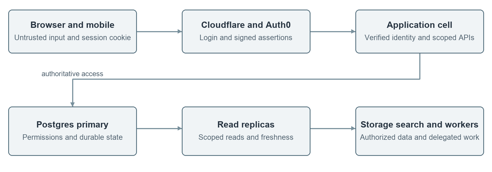
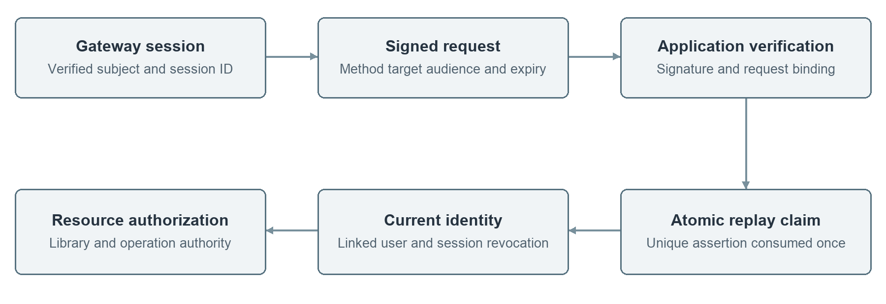
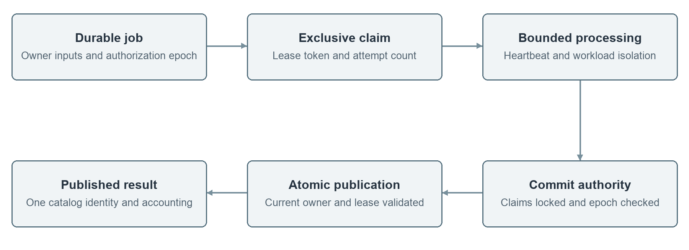

# Stillmark Security Architecture

Security team review edition • 27 October 2026 • Revision 1.0

> **Target-state design — not the deployed system.** This document describes where the
> architecture is designed to go. Controls that depend on multiple application cells, database shards or read replicas are **not built**, because those components do not exist yet. Controls in production today are described in [catalog row-level security](../CATALOG-RLS.md), [runtime identities](../RUNTIME-IDENTITIES.md) and [session revocation](../SESSION-REVOCATION.md).
> The system that exists today is described in [the current architecture](../ARCHITECTURE.md)
> and [production operations](../PRODUCTION.md).

## Differences from the deployed system

Read this list before relying on any statement below.

| Statement in this design                                   | Deployed system today                                                                                                                            |
| ---------------------------------------------------------- | ------------------------------------------------------------------------------------------------------------------------------------------------ |
| Application cells, database shards, routing generations    | Not built. One application, one database.                                                                                                        |
| Read replicas and the replica read sequence                | Not built. All reads use the primary.                                                                                                            |
| Sessions last one hour idle, twelve hours absolute         | True for ordinary sign-ins. A user may also choose a remembered sign-in that lasts 30 days ([session revocation](../SESSION-REVOCATION.md)).     |
| Gateway network policy scoped to Cloudflare address ranges | Not applied. The gateway service identity is protected by its key-pair credential and role, and the app verifies a signed per-request assertion. |
| Content scanning before distribution                       | Not built. Uploads are validated by type, size and decoder, not scanned for malware.                                                             |
| Tenant budgets and circuit controls                        | Partly built: per-member upload allowances and admission limits exist; general per-tenant rate limits do not.                                    |
| Step-up authentication for privileged operations           | Not built. Administrative operations require the administrator role on a current session.                                                        |
| Source snapshot `de328cc`                                  | The design was written against that commit and has not been re-verified line by line since.                                                      |

The controls that are in production, with their stated limits, are in
[catalog row-level security](../CATALOG-RLS.md),
[runtime identities](../RUNTIME-IDENTITIES.md),
[session revocation](../SESSION-REVOCATION.md) and the [threat model](../THREAT-MODEL.md).

Stillmark protects a private media platform spanning browser and mobile clients, Cloudflare, Auth0, Snowflake App Runtime, Snowpark Container Services, PostgreSQL, internal media stages, and AI search services. This document specifies the end-state security architecture, its enforcement boundaries, and the controls supporting operation across multiple application cells and database shards.

The security model binds each request to a verified identity or a deliberately issued sharing capability. The owning library remains the authority for its media, permissions, processing jobs, and derived data. Database replicas, caches, search indexes, and worker queues operate within that authority. Security decisions remain explicit across asynchronous processing and horizontal scaling.

## Review purpose

Review the identity chain, authorization boundaries, data protection, replica consistency, worker delegation, public sharing, operational controls, and security verification requirements as a unified system. The architecture supports a repeatable cell model with independent application, upload, database, search, and batch capacity.

## Security principles

**Verified identity:** the browser cannot assign itself a username, role, owner, shard, or worker privilege. **Explicit authority:** every data operation derives its scope from a verified principal and resource relationship. **Controlled publication:** a worker publishes only while its lease and delegated authority remain valid. **Protected reads:** authorization precedes metadata disclosure and media delivery. **Traceable operations:** security events carry correlation and operation identifiers without recording credentials or private media payloads.

## Document conventions

Present-tense descriptions define the intended end-state architecture, not current behaviour. Source references identify repository mechanisms and tests supporting those contracts. Platform references describe provider behavior; application policy determines how that behavior is used. No credentials, personal media, private share URLs, or deployment secrets are included.

# 01 Security boundaries and system context

Figure 1. Identity is verified at the gateway and application. The primary database establishes authorization; downstream services operate within that scope.

The browser is an untrusted input source. Cloudflare terminates the public application entry point, processes the Auth0 login flow, enforces request-origin checks, and forwards a signed identity assertion. Snowflake authenticates the service transport. The application validates the assertion independently and resolves the user's current application identity and permissions.

A transport credential grants access to the application endpoint; it does not replace the visitor's identity. The application establishes transaction-local identity in PostgreSQL and applies resource-specific checks. Media delivery, search, worker execution, and administrative operations use separate, explicit authorization paths.

Each application cell contains an application service group, upload services, a PostgreSQL primary and read replicas, scoped storage references, search partitions, and batch workers. The owner placement directory selects a cell from trusted configuration. It carries placement information, not permission to read another library.

Cloudflare, Auth0, and map providers have defined service responsibilities. Private originals and derivatives remain in Snowflake internal storage. Public map tile delivery is separated from private media authorization and does not forward gallery credentials.

# 02 Protected information and ownership

The security domain is the owning library. Immutable library identifiers connect media, albums, permissions, jobs, and search records to that authority. A person's login may have access to multiple libraries; viewing a shared album does not transfer ownership or create a second authorization source.

| Information class                    | Protection contract                                                                                           |
| ------------------------------------ | ------------------------------------------------------------------------------------------------------------- |
| Original photos and videos           | Authenticated or capability-authorized delivery; immutable storage references; controlled original downloads. |
| Thumbnails and display renditions    | Same resource authority as originals; explicit cache and revalidation policy.                                 |
| GPS and capture metadata             | Field-level disclosure policy, including public-sharing location controls.                                    |
| Face crops and identities            | Library scope, recognition consent, confirmation and ignore state, controlled name disclosure.                |
| Descriptions OCR and embeddings      | Derived private content; owner-scoped search and result authorization.                                        |
| Credentials and signing material     | Server-side secret stores, restricted service identities, controlled rotation.                                |
| Share tokens and session identifiers | Capability or session treatment; no logging of raw values.                                                    |
| Audit and usage records              | Restricted access, minimized content, retention policy and correlation identifiers.                           |

Data classification follows the content through every representation. A search document, face vector, or thumbnail retains the owner's protection requirements. Activity summaries and aggregate reports apply the caller's permitted scope rather than exposing global counts by default.

Globally stable public identifiers and cell-qualified internal references preserve ownership during scaling and migration. A caller cannot choose an arbitrary database hostname or alter a routing generation. Cross-library reads are authorized at the library that owns the resource.

# 03 Login and session establishment

Auth0 supplies the external identity. The gateway uses the authorization-code flow with PKCE, state, and nonce. The callback exchanges the authorization code against the configured issuer and validates the returned ID token against the issuer's keys, expected audience, permitted signing algorithm, required claims, nonce, and authorized party when present.

The login flow cookie and application session are encrypted using authenticated encryption. The reviewed gateway implementation uses JOSE with direct key management and A256GCM. Session cookies use the __Host prefix, Secure, HttpOnly, SameSite=Lax, and a root path. Session identity contains the Auth0 subject and a generated session ID rather than browser-supplied role assignments.

The login origin is explicitly configured and validated as HTTPS. Redirects use controlled destinations. Token exchanges have a bounded timeout and do not follow arbitrary redirects. Authentication errors are returned through controlled responses, with sanitized operational diagnostics.

## Session lifetime

A session has a one-hour idle window and a twelve-hour absolute lifetime. Eligible foreground activity renews the idle window without moving the absolute ceiling. Passive polling does not keep a session alive indefinitely. Session renewal retains the same revocation identity so a copied older cookie remains subject to the same logout decision.

## Identity administration

Account enrollment, disablement, role changes, and account linking use privileged, freshly authorized operations. The mapping from external subject to managed application identity is server controlled. Privileged human access uses centrally governed authentication policy and step-up authentication for sensitive administration.

Code anchors: `cloudflare-gateway/auth.mjs`, `lib/identity/auth.ts`, `lib/identity/auth0-management.ts`. Verification anchors: gateway session renewal and revocation tests, `tests/auth.test.ts`, and `tests/auth0-management.test.ts`.

# 04 Signed requests and replay protection

Figure 2. The assertion binds identity to one request. An atomic replay claim and current session lookup precede application data access.

The gateway signs a short-lived HMAC SHA-256 assertion containing subject, session ID, issue time, expiry, audience, unique request identifier, HTTP method, and path plus query. The application validates the signature with a timing-safe comparison and checks the structure and bounds of each claim. Assertion lifetime is at most thirty seconds.

Untrusted identity and request-binding headers are overwritten before authorization. The application compares the signed method and target against its own request values. The gateway sends the assertion only to a configured HTTPS Snowflake application origin. The transport user must match the configured gateway service identity.

PostgreSQL atomically consumes the unique assertion identifier while resolving the linked identity and session state. Repeated authorization checks inside one server request share that verified bootstrap; a different request cannot replay the same assertion. A legitimate transport retry obtains a newly signed assertion while retaining the business operation's idempotency key.

For uploads, the gateway receives a bounded chunk before generating the thirty-second assertion. This preserves the identity window for forwarding and authorization rather than spending it on a slow browser transfer. Assertion expiry is not extended to accommodate unbounded client upload time.

Code anchors: `cloudflare-gateway/proxy.mjs`, `lib/identity/gateway-assertion.ts`, `lib/identity/gateway-auth.ts`, `proxy.ts`. Verification anchors: `tests/gateway-assertion.test.ts`, `tests/gateway-replay.test.ts`, and `tests/gateway-auth.test.ts`.

# 05 Session revocation and permission freshness

Logout commits a revocation record before reporting successful completion. The revoked session ID comes from the verified signed assertion, not a request body field. Identity bootstrap checks revocation before using role metadata. Subsequent authorization checks reject that session, including a copied cookie.

Revocation is defined at authorization time. A request authorized before a revocation commit may finish; already-delivered bytes remain with the recipient. New requests use current session and resource authorization. The same boundary applies to share revocation and original-download permission changes.

## Bounded role caching

Gateway role metadata is cached for fifteen seconds with a key including the external subject, mapped account, identity marker, and authorization epoch. Native Snowflake role verification uses a separate sixty-second cache keyed by the authorization epoch, caller, current role, and exact token digest. Cache reads preserve the original expiry rather than extending it.

Administrative and access-management operations use fresh role checks. Request-local coalescing avoids repeating an identical verification inside a request, while bounded caches and in-flight coalescing control concurrent work across requests. Denial or verification failure never grants a fallback privilege.

## Authorization lifecycle

Account disablement, changes to role assignments, logout, album sharing, and ownership changes have explicit invalidation semantics. The owning primary remains authoritative for mutable access. Authorization epochs and resource revisions propagate invalidation through cached identity, queued work, and derived representations.

Code anchors: `lib/identity/auth.ts`, `lib/identity/auth-state.ts`, `lib/identity/gateway-auth.ts`, `lib/identity/shared-role-cache.ts`, and `docs/SESSION-REVOCATION.md`. Verification includes copied-cookie rejection, failed logout handling, fixed session ceilings, cache expiry, and fresh administrative checks.

# 06 Application and database authorization

Application authorization combines identity, role capability, ownership, explicit sharing, and resource state. A general viewer role does not confer access to every album. Album checks determine whether the principal can view or edit the requested resource. Read-only administrative capability remains distinct from write and access-management capability.

PostgreSQL row-level security supplies a second enforcement layer. The application authenticates before checking out a database connection and sets transaction-local values for verified username, administrative capabilities, write access, access management, and public-share hash. Commit or rollback clears the identity with the transaction. A failed rollback destroys the connection instead of returning it to the pool.

## Roles and bounded privilege

| Principal                | Authority                                                                 |
| ------------------------ | ------------------------------------------------------------------------- |
| Application user context | Resource access defined by ownership sharing and permitted capabilities.  |
| Public share context     | Only the current capability's album and selected media scope.             |
| Read-only administrator  | Authorized reads without mutation capability.                             |
| Access manager           | Freshly verified identity and access administration.                      |
| Maintenance service      | Explicit background operations through a separately scoped database role. |
| Upload and batch workers | Assigned workload and validated delegated ownership.                      |
| Provisioning operator    | Controlled infrastructure lifecycle outside ordinary request execution.   |

Narrow security-definer functions support specific bootstrap and maintenance operations with a fixed search path and restricted execution grants. Ordinary media lookup uses an invoker-security path and verified user context. Elevated lookup is a separate verified administrative path.

Runtime roles, function ownership, grants, policies, and transaction identity form one control system. Service processes protect credentials and trusted identity establishment. Cell-specific credentials and workload isolation further constrain the authority available to each process.

Code anchors: `lib/postgres.ts`, `lib/albums/album-access.ts`, `lib/media/media-lookup.ts`, `setup/72-app-rls.sql`, and catalog policy migrations. Verification anchors: `tests/catalog-rls.test.ts`, `tests/people-rls.test.ts`, `tests/postgres-read-identity.test.ts`, and `tests/media-lookup-permissions-first.test.ts`.

# 07 Public sharing capabilities

Public links deliberately grant possession-based access without a login. Creation requires album edit authority and an explicit expiry. Tokens are generated from thirty-two cryptographically random bytes and encoded as a forty-three-character URL-safe value. PostgreSQL stores a SHA-256 hash; the raw token is returned only when the link is created.

Every public request validates the hash, expiry, revocation state, and current album ownership. Links can cover the entire album or an explicit selected-photo set. Selection creation verifies that every requested photo belongs to the authorized album. Expiry is bounded to the next ninety days.

| Share setting         | Enforcement                                                                                                            |
| --------------------- | ---------------------------------------------------------------------------------------------------------------------- |
| Whole album           | Current authorized album membership, including later additions under the documented sharing contract.                  |
| Selected photos       | Explicit membership set; only selected media pass capability authorization.                                            |
| Original downloads    | Server-side original and ZIP permission checks; a ZIP re-checks the link and each file's membership before every file. |
| Location disclosure   | Explicit projection of permitted location fields.                                                                      |
| People names          | Controlled name and face-box disclosure from the public people projection.                                             |
| Expiry and revocation | Validated for each new public request.                                                                                 |

Public responses use private no-store behavior, no-referrer, noindex, nofollow, noarchive, and nosniff headers. The gateway's anonymous route allowlist accepts only the defined share routes and methods. The shared-link management page does not reveal the original raw token later.

Public media delivery distinguishes prepared display renditions from originals. A display alias cannot expose original video bytes when original downloads are disabled. Public metadata is explicitly projected rather than spreading arbitrary database fields. Location and people switches govern structured disclosure; owners control whether original files containing embedded metadata are downloadable.

Code anchors: `lib/albums/public-albums.ts`, `lib/photos/public-photo-details.ts`, and `app/share/[token]/media/[photoId]/route.ts`. Verification covers expiry, ownership, selection, field projection, original-download restrictions, and public people visibility.

# 08 Media access and cache boundaries

Every new private media request receives a live application permission check before a stage object is delivered. The check resolves the requested path or media identity within the caller's scope. The gateway receives a server-generated handoff containing an authorized storage path and content type; the browser cannot turn that mechanism into arbitrary storage access.

Presigned storage URLs remain within the server-side delivery path. URL reuse is independent of permission reuse: an internally cached storage URL does not authorize the viewer. Original and derived stages have separate permissions, and generated paths are validated before signing or fetching.

## Cache policy

Catalog thumbnails may use private browser storage with mandatory revalidation. The policy is private, no-cache, max-age=0, must-revalidate. Before forwarding a validator to storage, the gateway repeats current session and album authorization. A successful 304 response reuses bytes only after that check.

Display images, videos, original downloads, public shares, and errors use no-store behavior. Private media is not placed in a shared public cache. Cached metadata and signed-storage lookups carry bounded lifetimes and content identity. Permission changes remain authoritative at the application boundary.

Streaming preserves byte ranges for video and propagates client cancellation. Selected socket failures can be retried before response headers are committed; a response body is not transparently replayed after bytes have been sent. The database transaction ends before long media streaming.

Code anchors: `lib/media/media-handoff.ts`, `lib/media/media-lookup.ts`, `lib/media/media-fetch.ts`, `lib/media/image-urls.ts`, `lib/thumbnail-cache.mjs`, and `cloudflare-gateway/media-delivery.mjs`. Verification includes unauthorized paths, public originals, range handling, revalidation, and credential stripping.

# 09 Browser and request security

The gateway verifies the public request origin against configured application origin. Mutating methods require the expected Origin header and reject cross-site Fetch Metadata. Application mutation helpers enforce same-origin requests again, use configured trusted origins when ingress rewrites Host, and require HTTPS in production.

The application overwrites client-supplied nonce and request-binding headers. HTML rendering uses a generated nonce with a script policy including self, the nonce, strict-dynamic, and script-src-attr none. The policy prohibits object embedding and constrains the document base. Public share pages use their own controlled rendering path and security headers.

| Control             | Behavior                                                                  |
| ------------------- | ------------------------------------------------------------------------- |
| HTTPS               | Secure session cookies and HSTS response policy.                          |
| Framing             | Same-origin framing controls and frame-ancestors policy.                  |
| Content handling    | nosniff and explicitly selected media types.                              |
| Browser permissions | Camera microphone and browser geolocation disabled by Permissions-Policy. |
| Referrers           | Same-origin default; public shares use no-referrer.                       |
| API caching         | Private no-store policy.                                                  |
| JSON input          | Bounded stream read, object-shape validation, typed field validation.     |

The browser displays descriptions, OCR, filenames, captions, and model output as data. Structured response projection and contextual escaping prevent those fields from being interpreted as privileged markup or executable instructions. Public pages preserve the same disclosure contract as their media endpoints.

The gateway accepts only supported HTTP methods and configured upstream origins. Internal health-monitor paths are not public administrative interfaces. Upload-only services expose an exact route allowlist rather than the complete application UI or administrative API.

Code anchors: `lib/identity/auth.ts`, `lib/http.ts`, `proxy.ts`, `next.config.mjs`, `cloudflare-gateway/proxy.mjs`, and `lib/upload-service-policy.mjs`. Verification includes `tests/csp.test.ts`, gateway proxy tests, and upload-service route tests.

# 10 Upload admission and content integrity

Upload admission verifies the caller, album access, ownership, and routing generation before accepting bytes. The server records a stable upload identity and expected chunk count. Completion seals metadata and creates durable processing work; the client does not submit arbitrary server filesystem or stage paths.

The transfer protocol uses eight-MiB chunks. Image files are bounded to sixty-four MiB and video files to four GiB, with separate thumbnail limits. Streaming reads enforce actual received bytes rather than relying only on Content-Length. Gateway buffering is bounded and concurrent chunk buffering receives explicit backpressure.

## Integrity and consistency

Each chunk is recorded with its index, length, storage reference, and SHA-256 digest. Repeating the same chunk is idempotent; changing its content or the declared upload metadata is rejected. Retrieval verifies length and digest. Completion checks the sealed inputs before publication.

Image processing decodes media under pixel limits. The reviewed Sharp path bounds original images to eighty million input pixels and supplied thumbnails to eight million pixels. File hashing supports duplicate detection within the authorized album. Stage names are sanitized; temporary video paths are generated on the server.

## Processing containment

Media parsers run with bounded CPU, memory, disk, and elapsed-time allowances in workload-specific services. Decoding and transcoding use validated local inputs and restricted outbound connectivity. Content admission applies file-type policy and scanning before distribution. Temporary artifacts are tied to upload ownership and a controlled lifecycle.

Request size, queued bytes, file counts, and concurrency are governed by workload and tenant budgets. Queue admission returns an explicit retryable response when capacity is unavailable. Acceptance does not create an unbounded inference or transcoding fan-out.

Code anchors: `lib/upload/upload-limits.ts`, `lib/upload/upload-sessions.ts`, `lib/upload/upload-chunk-stage.ts`, `lib/upload/upload-processing.ts`, `lib/upload/upload-source.ts`, and `lib/http.ts`.

# 11 Worker identity and publication controls

Figure 3. Durable work carries owner scope and a claim generation. Publication rechecks both ownership and delegated authority inside the transaction.

A queued job contains immutable input references, owner identity, authorization epoch, operation identity, and processing state. It does not contain a browser password or an unrestricted user token. Workers claim eligible jobs using database coordination and receive a unique lease token.

The upload worker uses a five-minute lease and renews it every thirty seconds without overlapping renewals. It validates delegation age and authorization state. Expired claims can be recovered by another worker, but only the current claim generation can publish. A stopped worker does not acquire new work while draining.

Publication locks and checks the job and upload-completion claims. The transaction validates the current lease, authorization epoch, resource authority, and any existing result before committing catalog changes and completion accounting. Repeating preparation or storage operations does not produce a second published photo.

Batch services use separate workload roles and compute pools for faces, OCR, embeddings, video conversion, and saved rankings. Each job operates against bounded input scope and resource budgets. Completion creates versioned derived output and controlled follow-up work; it does not silently grant broader access.

Code anchors: `lib/upload/upload-processing-jobs.ts`, `lib/upload/upload-processing-worker.ts`, `lib/upload/upload-completion-claim.ts`, `lib/upload/upload-routing-control.ts`, and `lib/search/search-batch-control.ts`. Verification covers claim replacement, expired leases, publication fencing, route drainage, and authorization changes.

# 12 Retries timeouts and failure containment

Retries are classified by operation and outcome. Reads, chunk transfer, processing claims, and external paid calls have different replay contracts. A business operation retains a stable identifier across attempts, while each transport request receives its own authentication assertion and correlation ID.

| Mechanism              | Control behavior                                                                                           |
| ---------------------- | ---------------------------------------------------------------------------------------------------------- |
| Browser transfer       | Bounded attempts and exponential delay; bounded Retry-After handling; access denials stop automatic retry. |
| Upload processing      | Attempt counter, deferred retry time, finite attempt budget, visible terminal failure.                     |
| Worker recovery        | Lease expiry and claim-generation fencing preserve a single authorized publication.                        |
| Connection acquisition | Deadline; a late connection is released without executing abandoned work.                                  |
| SQL transport          | Scoped abortable authorization requests and bounded connection cleanup.                                    |
| Media transport        | Selected pre-header socket retry; no replay after body streaming begins.                                   |
| External inference     | Recorded attempt identity and outcome reconciliation before another chargeable dispatch.                   |

The reviewed client defaults to four attempts. Queued processing permits up to five attempts and applies a capped exponential delay. The complete retry policy adds randomized scheduling and per-dependency retry budgets so concurrent clients do not retry in lockstep. A terminal failure retains the reason and permitted retry context.

Timeout handling preserves the original deadline through nested helpers. Circuit controls and admission limits protect downstream capacity. Permission checks fail closed; an unavailable dependency does not cause a request to switch to a more privileged credential.

Operators can inspect and replay failed work through authorized controls. Replay revalidates owner access, inputs, current resource state, and operation identity. Unknown mutation outcomes are reconciled before re-execution. Cancellation and publication use the same authoritative state boundary.

Code anchors: `lib/upload/upload-client.ts`, `lib/upload/upload-processing-policy.ts`, `lib/connection-deadline.ts`, `lib/snowflake/snowflake-query-deadline.ts`, and `lib/media/media-fetch.ts`.

# 13 Secrets and machine credentials

Secrets are supplied through managed server-side secret mechanisms and restricted deployment bindings. Application code, browser bundles, documentation, logs, and Git history do not contain live credentials. Secrets are separated by purpose: session encryption, gateway assertion signing, database roles, Snowflake ingress, credential renewal, and identity management.

## Gateway credential lifecycle

A private Durable Object coordinates the Snowflake gateway token lifecycle. Stored token material is encrypted with a key derived from the gateway session secret. A dedicated RSA credential signs short-lived renewal requests. The renewal role has narrowly scoped programmatic-authentication management authority, while the active ingress token uses a separate application access role.

The renewal check runs on a schedule and renews when seven days or less remain. Rotation preserves a twenty-four-hour overlap. A candidate token must pass an application health check before activation. The pending credential and request identity are persisted so repeated checks reconcile the same rotation rather than creating uncontrolled duplicates.

## Rotation and separation

Session-encryption key rotation coordinates re-encryption of dependent private storage. Signing-key rotation uses an explicitly managed transition and invalidation policy. RSA rotation uses overlapping key slots with verification before retiring the old key. Database credentials and worker secrets are restricted to their cell and workload.

Administrators obtain privileges through controlled management paths. Runtime users do not inherit the provisioning operator's rights. Expired credentials are replaced through authorized renewal, not by falling back to a more privileged account. Recovery preserves auditable ownership of each change.

Code anchors: `cloudflare-gateway/token-renewal.mjs`, `lib/snowflake.ts`, `lib/postgres.ts`, and `setup/32-gateway-token-renewal.sql`. Tests verify encryption, concurrent renewal coalescing, activation checks, request-ID reuse, and preservation of the last active credential on a failed renewal.

# 14 Network and service isolation

The architecture uses HTTPS for application and service traffic and validates PostgreSQL TLS certificates. Configured database connections use certificate verification, including explicit CA material where required. Database endpoints and service origins come from trusted configuration rather than request-provided hosts.

Network policies constrain service-account ingress. The gateway policy is scoped to the Cloudflare address ranges used by its transport, with credential and role checks providing the service identity. Network rules also control PostgreSQL access and external service integration endpoints.

| Boundary                | Isolation control                                                          |
| ----------------------- | -------------------------------------------------------------------------- |
| Public edge to origin   | Configured HTTPS origin, authenticated transport, signed request identity. |
| Application to database | Verified TLS, distinct roles, scoped pools and transaction identity.       |
| Upload service          | Exact upload and health route allowlist; gateway identity required.        |
| Batch services          | Workload-specific grants, input scope and network integration.             |
| Search and inference    | Approved endpoints and service roles; no browser-held provider secret.     |
| Administration          | Separate credentials and management authority.                             |

Egress policies admit the required storage, database, inference, and integration endpoints. Media handoff and map routing validate destination shape before forwarding and strip application credentials from downstream provider requests. Redirect handling is explicit for authentication and credential-management operations.

Every cell has its own service and data-plane scope. Autoscaling creates instances from the same reviewed role and network templates. The control plane validates configuration before routing users to a new cell. Test infrastructure has separate identities, data, and resource names, and is not a production authorization path.

Repository anchors: gateway proxy and media-delivery modules, `lib/postgres.ts`, upload-service policy, deployment templates, and `docs/GATEWAY-TOKEN-RENEWAL.md`. Operational review verifies the applied policy bindings and grants alongside their declarative definitions.

# 15 Read replica authorization and consistency

Read replicas serve approved read classes while the primary remains the authority for mutable permissions, revocation, job state, and publication. The router selects named operations, not arbitrary SQL based on whether its text starts with SELECT. Replica database roles are read only and retain equivalent tenant policies.

## Secure read sequence

1. Resolve verified identity and owning library placement.
2. Establish current authorization on the primary.
3. Select an eligible read class and verify replica freshness.
4. Execute the scoped read with bounded duration and result size.
5. Revalidate visibility and sensitive revisions on the primary before disclosure.
6. Return the authorized projection or use a bounded primary route.

After a mutation, a causal token or equivalent validated content revision prevents older data from being served as the updated result. A WAL fence, when used, represents a post-commit position. A fixed elapsed time alone is not used as proof that replication has caught up.

Sensitive changes include revocation, deletion, location removal, face-name privacy, and selected-share membership. A replica row is refreshed or suppressed when the primary identifies a newer sensitive revision. Public capability checks and queue-state transitions remain on the primary.

Replica loss or lag removes the endpoint from eligible routing. Fallback has a reserved primary capacity budget and does not bypass security checks. Pools are separately scoped to primary and replica endpoints; connection reuse never carries a previous user's identity.

Snowflake provides read replicas with inherited network policy and replicated credentials [S1]. Stillmark applies its own read-class, consistency, and authorization contracts around that platform behavior. Replica access is separate from the primary's high-availability recovery role.

# 16 Tenant sharding and secure movement

The routing directory maps a stable owning-library identity to a cell, shard, and routing generation. It does not accept a user-provided database address. Shared resources resolve to their owner's authority, even when the viewer belongs to another cell.

New cells are provisioned from controlled templates containing network policy, secrets references, database roles, schemas, row-level policies, storage scope, service configuration, and audit destinations. Readiness includes identity isolation and authorization checks before the directory admits user traffic.

## Tenant movement

Movement preserves stable media IDs, ownership, sharing capabilities, authorization epochs, job state, and search revisions. The destination is prepared and validated before cutover. The source fences new mutations and queue claims while the migration reconciles accepted work and final changes.

An atomic directory generation change selects the destination. The source rejects writes using the superseded generation. Workers cannot publish against stale ownership or route state. Cross-cell links continue to resolve through stable resource identities and current owner authorization.

## Shared discovery

A recipient's collection may contain a reference to an album in another cell. That reference is a discovery record; permission is evaluated at the owner's cell. Search and collection fan-out are bounded and return only authorized records. A revoked grant removes access independently of asynchronous discovery cleanup.

Provisioning and migration use administrative service identities, persisted operation IDs, bounded concurrency, and auditable state transitions. Retried provisioning discovers its prior result before creating another resource. Secrets and endpoint mappings remain outside browser input and user-editable metadata.

Design references: `docs/architecture/stillmark-target-state.md`, the transaction identity controls in `lib/postgres.ts`, and the ownership and sharing model in `lib/albums/album-access.ts`.

# 17 Search inference and facial information

Search operates within verified library scope. The query layer resolves current visibility, applies trusted partition and owner filters, and validates result identities before returning metadata or media. Names, OCR, captions, descriptions, tags, dates, and location remain subject to the same authority as their source photo.

Cortex Search runs with service-owner rights [S2]. Application-side user authorization therefore accompanies service access. Search results do not substitute for PostgreSQL permissions. Sensitive changes and deletions are propagated as versioned updates or tombstones, while the primary validation gate enforces current disclosure.

## AI input and output controls

Inference uses approved models and endpoints with server-held credentials. Inputs contain only the data needed for the authorized operation. Model responses are validated against a constrained schema before storage. Generated text and OCR are treated as content, not instructions to execute SQL, change access, call arbitrary tools, or select a database shard.

Natural-language intent parsing produces constrained query structures. Deterministic validation limits supported fields, operators, identifiers, and result budgets. Model output cannot create an authorization predicate or override one. Stored embeddings and saved rankings retain owner scope and source revision.

## Facial information

Recognition follows library consent and face-management policy. Confirmed identity, candidate assignment, and ignored state remain distinct. Only eligible confirmed identity contributes to confirmed-person search. Public name disclosure is controlled by the share setting and permitted people projection. Face crops have their own authorized read path.

Face names that are equivalent for search remain separate underlying ownership records. A combined display entry does not merge permissions across libraries. Consent withdrawal, deletion, and identity edits propagate to derived data and search through controlled revision processing.

Code anchors: `lib/search.ts`, `lib/search/search-intent.ts`, `lib/people/people-search.ts`, `lib/people/face-crops.ts`, `lib/photos/public-photo-details.ts`, and `lib/ai-categorize.ts`. Verification includes people RLS and public people disclosure tests.

# 18 Data lifecycle and recovery

Original media, derivatives, catalog metadata, face information, search records, and operational data follow documented retention and deletion policies. Deletion begins with an authorized state transition. Catalog visibility changes and derived-data invalidation prevent new disclosure while physical cleanup proceeds.

Storage cleanup uses durable intents and bounded manifests. It checks live references, active upload inputs, retained retries, and published originals before deleting an object. Retrying cleanup reconciles the intended outcome instead of treating an ambiguous response as permission for unrelated removal.

## Recovery protection

Backups and restore environments are access controlled and encrypted through the approved storage and platform configuration. Restore execution is a privileged operation. Recovered data retains its ownership, row-level policies, function grants, and session or capability state needed to preserve access rules.

Restoration validates more than row counts. It verifies referential integrity, security functions, denied unscoped access, role separation, and the relation between catalog references and media. Recovery jobs do not replay completed external side effects solely because a processing record has reappeared.

Tenant deletion encompasses derived indexes, embeddings, face crops, public links, caches, replicas, and retained copies according to the retention policy. Tombstones and revision history preserve deletion semantics when a replica or restored environment rejoins service.

Recovery environments are isolated from ordinary user traffic until controls are validated. Promotion is an explicit operation with an auditable decision and compatible application and schema versions. High availability, replicas, and backups serve distinct purposes while preserving the same authorization model.

Code anchors: `scripts/verify-backup.py`, `scripts/release/`, upload storage and publication modules, and catalog policy migrations. Restore validation is part of the release assurance process.

# 19 Audit monitoring and operational access

Security telemetry correlates gateway, application, database, media delivery, and asynchronous processing with request and operation identifiers. Events record the actor's verified identity reference, resource scope, action, outcome, time, and service version where appropriate. Credentials, raw cookies, raw share links, signed storage URLs, and private media payloads are excluded.

| Event class      | Recorded security context                                                   |
| ---------------- | --------------------------------------------------------------------------- |
| Authentication   | Outcome, issuer flow stage, session lifecycle and correlation ID.           |
| Authorization    | Permitted or denied action, scope and safe reason category.                 |
| Sharing          | Creation, expiry, revocation, selected scope and disclosure policy changes. |
| Administration   | Actor, fresh authorization, changed capability and result.                  |
| Worker execution | Job identity, claim generation, attempt, publication and terminal outcome.  |
| Secret rotation  | Credential purpose, activation outcome and expiration metadata.             |
| Data lifecycle   | Delete intent, cleanup outcome, restore validation and promotion.           |

Detailed audit access is separated from ordinary user activity views. Log retention, export, and administrative reads are controlled. High-cardinality identifiers remain in restricted traces rather than broad metric labels. Diagnostics are sampled and capped, with structured safe fields.

Operational access follows least privilege. Cost refresh, batch controls, scaling policy, and provisioning are administrative operations. Status reads do not silently initiate expensive or privileged work. Every automatic controller has a bounded authority, persisted decisions, and an operator stop control.

Incident response uses the same explicit controls: revoke sessions or links, disable identities, rotate credentials, isolate a cell or worker group, and preserve audit evidence. Resumption verifies identity, routing, and data consistency before normal traffic returns.

Code anchors: `lib/observability/user-activity.ts`, `lib/identity/identity-logs.ts`, `lib/upload/upload-request-trace.ts`, `cloudflare-gateway/diagnostics.mjs`, and credential renewal modules. Diagnostic tests verify exclusion of URLs, cookies, tokens, and user content.

# 20 Secure delivery and configuration assurance

Source control, dependency locks, configuration templates, migration checks, test gates, and restore verification support repeatable releases. Runtime artifacts have identifiable versions and source provenance. Production and isolated-test configuration are rendered from controlled inputs rather than edited by end-user requests.

The release workflow checks types, application tests, gateway tests, dependency audit results, configuration consistency, migrations, and the production build. Database migrations preserve access boundaries through compatible changes. Deployment credentials are separate from application runtime credentials.

## Dependency and container controls

Dependency versions are resolved through lockfiles and reviewed updates. The Snowflake SDK timeout integration validates expected source hashes during installation. Native image and video components are included in the dependency and container review. Build inputs and model artifacts are pinned and verified through the release process.

Containers run workload-specific entry points with restricted mounted secrets, network integrations, and resource budgets. Artifact scanning and software inventory are associated with the immutable release. Administrative deployment records link application, worker, gateway, and schema versions.

## Release verification

Anonymous access checks, signed-in functional checks, public capability tests, role-boundary tests, and worker publication checks exercise distinct routes. A gateway deployment is verified independently of an application deployment. Rollback preserves database-policy compatibility and credential-rotation continuity.

Read replicas and additional cells use the same security validation suite before serving traffic. Autoscaling retains reviewed role, secret, network, and observability configuration across instances. Load testing uses isolated data and identities and preserves authorization behavior rather than disabling it for throughput.

Code anchors: `scripts/release/`, `scripts/verify-backup.py`, `scripts/snowflake-deadline/`, `config/templates/`, application and gateway lockfiles, and workload Dockerfiles.

# 21 Code and verification index

The following map connects security responsibilities to implementation and regression evidence. Paths are repository relative. The source snapshot reviewed for this document is commit `de328cc`.

| Control                  | Source anchor                                                   | Verification anchor                                                     |
| ------------------------ | --------------------------------------------------------------- | ----------------------------------------------------------------------- |
| Signed identity          | lib/identity/gateway-assertion.ts                               | tests/gateway-assertion.test.ts                                         |
| Replay claim             | lib/identity/gateway-auth.ts                                    | tests/gateway-replay.test.ts                                            |
| Session and roles        | lib/identity/auth.ts and lib/identity/gateway-auth.ts           | tests/auth.test.ts and tests/gateway-auth.test.ts                       |
| Login and renewal        | cloudflare-gateway/auth.mjs                                     | cloudflare-gateway/session-renewal.test.mjs                             |
| Logout                   | docs/SESSION-REVOCATION.md                                      | cloudflare-gateway/session-revocation.test.mjs                          |
| Transaction identity     | lib/postgres.ts                                                 | tests/postgres-read-identity.test.ts                                    |
| Catalog policies         | setup/72-app-rls.sql and migrations/postgres/                   | tests/catalog-rls.test.ts                                               |
| People visibility        | lib/people/face-crops.ts and lib/photos/public-photo-details.ts | tests/people-rls.test.ts and tests/public-album-people-security.test.ts |
| Public projection        | lib/photos/public-photo-details.ts                              | tests/public-album-details.test.ts                                      |
| Public original access   | app/share/[token]/media/[photoId]/route.ts                      | tests/public-media-security.test.ts                                     |
| Media authority          | lib/media/media-lookup.ts                                       | tests/media-lookup-permissions-first.test.ts                            |
| Worker fencing           | lib/upload/upload-completion-claim.ts                           | tests/upload-publication-fencing.test.ts                                |
| Browser policy           | proxy.ts and next.config.mjs                                    | tests/csp.test.ts                                                       |
| Gateway request controls | cloudflare-gateway/proxy.mjs                                    | cloudflare-gateway/proxy.test.mjs                                       |
| Credential rotation      | cloudflare-gateway/token-renewal.mjs                            | cloudflare-gateway/token-renewal.test.mjs                               |
| Diagnostic minimization  | cloudflare-gateway/diagnostics.mjs                              | cloudflare-gateway/diagnostics.test.mjs                                 |

Verification combines focused unit tests, policy execution against isolated schemas, protocol tests, and deployed acceptance checks. Code locations identify the enforcement mechanism; tests identify the scenario and expected outcome. Security requirements remain connected to those artifacts across changes.

# 22 Review evidence and control acceptance

Maintain execution evidence privately in `.release/`, bound to the exact source and deployed artifacts. The following controls define acceptance requirements, not a record of completed checks.

## Security acceptance outcomes

The review must validate the end-to-end identity chain; denial without identity; cross-library isolation; separation of read, write, and access-management privileges; replay rejection; session and share revocation; public disclosure controls; worker publication fencing; replica consistency; and controlled tenant movement.

Operational acceptance also verifies applied network rules, TLS trust, secret bindings, credential rotation, backups, restore access checks, audit access, and incident-response actions. Evidence records the exact artifact, configuration, environment, test identity class, outcome, and review date.

## Reference material

[S1] Snowflake. Snowflake Postgres Read Replicas. https://docs.snowflake.com/en/user-guide/snowflake-postgres/postgres-create-replica

[S2] Snowflake. Cortex Search overview and access model. https://docs.snowflake.com/en/user-guide/snowflake-cortex/cortex-search/cortex-search-overview

[S3] OWASP. Authorization Cheat Sheet. https://cheatsheetseries.owasp.org/cheatsheets/Authorization_Cheat_Sheet.html

Provider references were reviewed on 27 October 2026. OWASP's least-privilege, deny-by-default, per-request authorization, and authorization-testing principles inform the control organization [S3]. The document describes Stillmark's end-state design, not a third-party certification.

Repository companion: `docs/architecture/stillmark-target-state.md`. Supporting implementation documents include `docs/CATALOG-RLS.md`, `docs/SESSION-REVOCATION.md`, `docs/GATEWAY-TOKEN-RENEWAL.md`, and `docs/queued-upload-processing.md`.
